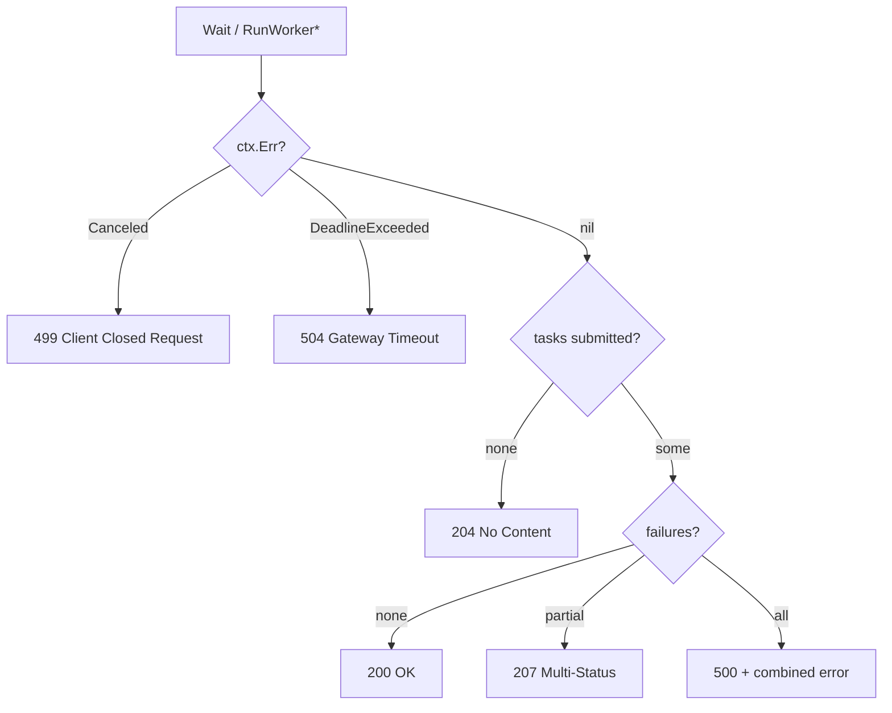

# replify

> Standardized, fluent, zero-dependency API response wrapping for Go REST services, with built-in pagination, tracing metadata, error stacks, a JSON path engine (`fj`), and replify-native concurrent execution.

[](https://go.dev/)
[](LICENSE)
[](https://pkg.go.dev/github.com/polarixa/replify)

## Table of Contents

- [Overview](#overview)
- [Installation](#installation)
- [Quick Start](#quick-start)
- [Usage Examples](#usage-examples)
  - [Writing responses (JSON, file, binary, Gin)](#usage-write)
  - [Building responses, metadata, pagination, debugging](#usage-build)
  - [Error handling with stack traces](#usage-errors)
  - [Parsing JSON back into a wrapper](#usage-parse)
  - [`fj`: JSON path extraction and transformers](#usage-fj)
  - [WorkerGroup / Pool: concurrent execution](#usage-workergroup)
- [API / Configuration Reference](#api-reference)
- [Best Practices](#best-practices)
- [Architecture Notes](#architecture-notes)
- [Testing & Benchmarks](#testing--benchmarks)
- [Contributing](#contributing)
- [License](#license)

<a id="overview"></a>

<details open>
<summary><strong>Overview</strong></summary>

**replify** removes the boilerplate of standardizing REST responses. It applies the Decorator Pattern through a fluent, chainable API so that error handling, metadata, pagination, debugging data, and signatures are layered onto a single response envelope with a consistent wire format across every endpoint.

<details>
<summary><strong>Problems addressed and design rationale</strong></summary>

| Problem                                                        | replify's answer                                                                           |
| -------------------------------------------------------------- | ------------------------------------------------------------------------------------------ |
| Inconsistent response formats across endpoints                 | One standardized envelope for all endpoints                                                |
| Repetitive error-handling boilerplate in every handler         | Fluent builders: `WithError`, `WithErrorAck`, `AppendError`, `OK()`, `Accepted()`, ...     |
| Manual metadata management (request IDs, timestamps, versions) | First-class `meta` object: request ID, API version, locale, timestamps, custom fields      |
| Pagination logic scattered across the codebase                 | Built-in `pagination` object (`page`, `per_page`, `total_items`, `total_pages`, `is_last`) |
| Debugging differences between production and development       | Conditional `debug` object, opt-in per environment                                         |
| Type safety                                                    | Full type safety with Go generics                                                          |
| Dependency footprint                                           | Zero dependencies: Go standard library only                                                |

</details>

<details>
<summary><strong>Key features</strong></summary>

- **Standardized JSON format**: a consistent structure across all API responses.
- **Fluent builder pattern**: chain methods to construct complex responses.
- **Pagination support**: `page`, `per_page`, `total_items`, `total_pages`, `is_last`, plus a cursor object.
- **Request tracing**: unique request IDs across microservices.
- **Internationalization**: locale support for multi-language APIs.
- **Debug mode**: conditional debugging information for development.
- **Error handling**: rich error information with stack traces and error wrapping.
- **Metadata**: API version, custom fields, timestamps.
- **Status helpers**: `IsSuccess()`, `IsClientError()`, `IsServerError()`, and more.
- **JSON parsing**: parse JSON strings back into wrapper objects (`UnwrapJSON`).
- **Framework-independent writers**: `Write`, `WriteJSON`, `WriteFile`, `WriteBinary` against `http.ResponseWriter` (`net/http`, Gin, Echo, Fiber, ...).
- **`fj` JSON engine**: path-based extraction, search, aggregation, and transformers without full unmarshalling.
- **Concurrent execution**: `WorkerGroup`/`Pool` fan-out and persistent worker pools with replify-native aggregated results.

</details>

<details>
<summary><strong>When to use vs. when not to use</strong></summary>

**Use replify for:**

- **RESTful API development**: standardizing API responses.
- **Microservices**: consistent responses across services.
- **API versioning**: including version metadata.
- **Error standardization**: consistent error formats.
- **Pagination**: APIs returning paginated results.
- **Multi-tenant APIs**: including tenant/locale information.
- **Request tracing**: tracking requests across services.
- **Development debugging**: conditional debug information.

**Do not use replify for:**

- **GraphQL APIs**: GraphQL has its own response format.
- **gRPC services**: Protocol Buffers define the structure.
- **WebSocket APIs**: real-time bidirectional communication.
- **Simple CLIs**: overkill for command-line tools.
- **Internal services** where custom formats are required.
- **High-performance paths**: direct JSON encoding may be faster.

</details>

<details>
<summary><strong>Related packages in the replify ecosystem</strong></summary>

| Package                                                            | Purpose                                                              |
| ------------------------------------------------------------------ | -------------------------------------------------------------------- |
| [replify](https://github.com/polarixa/replify)                     | API response wrapping library (this package)                         |
| [conv](https://github.com/polarixa/replify/pkg/conv)               | Type conversion utilities                                            |
| [coll](https://github.com/polarixa/replify/pkg/coll)               | Type-safe collection utilities                                       |
| [common](https://github.com/polarixa/replify/pkg/common)           | Reflection-based utilities                                           |
| [encoding](https://github.com/polarixa/replify/pkg/encoding)       | JSON encoding utilities                                              |
| [hashy](https://github.com/polarixa/replify/pkg/hashy)             | Deterministic hashing                                                |
| [match](https://github.com/polarixa/replify/pkg/match)             | Wildcard pattern matching                                            |
| [msort](https://github.com/polarixa/replify/pkg/msort)             | Map sorting utilities                                                |
| [randn](https://github.com/polarixa/replify/pkg/randn)             | Random data generation                                               |
| [ref](https://github.com/polarixa/replify/pkg/ref)                 | Pointer utilities                                                    |
| [strutil](https://github.com/polarixa/replify/pkg/strutil)         | String utilities                                                     |
| [truncate](https://github.com/polarixa/replify/pkg/truncate)       | String truncation utilities                                          |
| [workergroup](https://github.com/polarixa/replify/pkg/workergroup) | OOP-style, live-scalable concurrency (error groups and worker pools) |

</details>

</details>

<a id="installation"></a>

<details>
<summary><strong>Installation</strong></summary>

**Prerequisites:** Go 1.24 or higher (`go.mod` declares `go 1.24.0`). With [Go modules](https://go.dev/wiki/Modules#how-to-use-modules), `go build|run|test` fetches the dependency automatically once the import is added.

<details>
<summary><strong>Install the latest version</strong></summary>

```bash
go get github.com/polarixa/replify@latest
# go: added github.com/polarixa/replify vX.Y.Z
```

</details>

<details>
<summary><strong>Install a specific version</strong></summary>

```bash
go get github.com/polarixa/replify@v0.1.0
# go: added github.com/polarixa/replify v0.1.0
```

</details>

<details>
<summary><strong>Import in code</strong></summary>

```go
package main

import (
    "fmt"

    "github.com/polarixa/replify"
)

func main() {
    fmt.Println(replify.New().OK().StatusCode()) // 200
}
```

</details>

</details>

<a id="quick-start"></a>

<details open>
<summary><strong>Quick Start</strong></summary>

<details open>
<summary><strong>Minimal runnable snippet</strong></summary>

```go
package main

import (
    "fmt"

    "github.com/polarixa/replify"
)

func main() {
    w := replify.New().OK().
        WithMessage("User retrieved successfully").
        WithBody(map[string]string{"id": "123", "name": "John Doe"})

    fmt.Println(w.JSON()) // {"data":{"id":"123","name":"John Doe"},"header":{"code":200,"text":"OK","type":"Successful"},"message":"User retrieved successfully","meta":{"api_version":"v0.0.1","locale":"en_US","request_id":"db848ff9djinl03ik1d0","requested_time":"2026-10-15 10:10:53.721643"},"status_code":200,"total":0}
}
```

</details>

<details>
<summary><strong>Output</strong></summary>

```json
{
  "data": {
    "id": "123",
    "name": "John Doe"
  },
  "header": {
    "code": 200,
    "text": "OK",
    "type": "Successful"
  },
  "message": "User retrieved successfully",
  "meta": {
    "api_version": "v0.0.1",
    "locale": "en_US",
    "request_id": "db848ff9djinl03ik1d0",
    "requested_time": "2026-10-15 10:10:53.721643"
  },
  "status_code": 200,
  "total": 0
}
```

</details>

</details>

<a id="usage-examples"></a>

<details>
<summary><strong>Usage Examples</strong></summary>

<a id="usage-write"></a>

<details>
<summary><strong>Example: Writing responses to http.ResponseWriter (JSON, file, binary, Gin)</strong></summary>

All writers are framework-independent and accept the standard `http.ResponseWriter`, so they work with `net/http`, Gin, Echo, Fiber, and any framework whose writer implements that interface. Implementation uses only `net/http`, `mime`, `path/filepath`, `os`, and `io`.

<details open>
<summary><strong>Native net/http handler (Write dispatch)</strong></summary>

`Write` dispatches automatically: filepath set → `WriteFile`; data is `[]byte` → `WriteBinary`; otherwise → `WriteJSON`. Content-Type and status code are set for you.

```go
package main

import (
    "log"
    "net/http"

    "github.com/polarixa/replify"
)

func GetUser(response http.ResponseWriter, request *http.Request) {
    user := map[string]string{"id": "123", "name": "John Doe"}

    w := replify.New().
        OK().
        WithBody(user).
        WithMessage("User retrieved successfully").
        Write(response)

    w.Slogging()

    if w.IsErrorPresent() {
        w.S().Errorf("Error writing response: %v", w.Error())
    }
}

func main() {
    http.HandleFunc("/user", GetUser)
    log.Fatal(http.ListenAndServe(":8080", nil)) // GET /user -> 200 application/json {"data":{"id":"123",...}}
}
```

</details>

<details>
<summary><strong>JSON</strong></summary>

```go
package main

import (
    "net/http"
    "net/http/httptest"

    "github.com/polarixa/replify"
)

func main() {
    user := map[string]string{"id": "123"}
    rec := httptest.NewRecorder()

    w := replify.New().
        WithStatusCode(http.StatusOK).
        WithBody(user).
        WithMessage("User retrieved successfully").
        Write(rec)

    if w.IsErrorPresent() {
        panic(w.Error())
    }
    println(rec.Code, rec.Header().Get("Content-Type")) // 200 application/json
}
```

</details>

<details>
<summary><strong>File</strong></summary>

```go
package main

import (
    "net/http"

    "github.com/polarixa/replify"
)

func Report(w http.ResponseWriter, r *http.Request) {
    // 200, Content-Type detected from the file extension (application/pdf)
    replify.New().
        File("/tmp/report.pdf").
        Write(w)
}

func main() { http.HandleFunc("/report", Report) }
```

</details>

<details>
<summary><strong>File attachment</strong></summary>

Serves the file with `Content-Disposition: attachment` so the browser offers a download dialog.

```go
package main

import (
    "net/http"

    "github.com/polarixa/replify"
)

func Download(w http.ResponseWriter, r *http.Request) {
    // Content-Disposition: attachment; filename=report.pdf
    replify.New().
        FileAttachment("/tmp/report.pdf", "report.pdf").
        Write(w)
}

func main() { http.HandleFunc("/download", Download) }
```

</details>

<details>
<summary><strong>Binary, binary with filename, and custom status code</strong></summary>

The filename drives MIME-type detection and the `Content-Disposition` header.

```go
package main

import (
    "fmt"
    "net/http"
    "net/http/httptest"

    "github.com/polarixa/replify"
)

func main() {
    data := []byte(`{"ok":true}`)

    rec := httptest.NewRecorder()
    replify.New().Binary(data).Write(rec)
    fmt.Println(rec.Code) // 200 (application/octet-stream)

    rec = httptest.NewRecorder()
    replify.New().Binary(data).Filename("report.pdf").Write(rec)
    fmt.Println(rec.Header().Get("Content-Type")) // application/pdf

    rec = httptest.NewRecorder()
    replify.New().WithStatusCode(http.StatusCreated).Binary(data).Filename("result.json").Write(rec)
    fmt.Println(rec.Code) // 201
}
```

</details>

<details>
<summary><strong>Gin</strong></summary>

replify does **not** import Gin; it depends only on `http.ResponseWriter`. Gin's `c.Writer` implements it, so pass it directly (the consuming module must depend on `github.com/gin-gonic/gin`).

```go
package main

import (
    "github.com/gin-gonic/gin"
    "github.com/polarixa/replify"
)

func Download(c *gin.Context) {
    replify.New().
        FileAttachment("/tmp/report.pdf", "report.pdf").
        Write(c.Writer) // 200 with Content-Disposition: attachment
}

func main() {
    r := gin.Default()
    r.GET("/download", Download)
}
```

</details>

<details>
<summary><strong>Dispatch rules and safe filename handling</strong></summary>

| Condition          | Writer called |
| ------------------ | ------------- |
| `filepath` is set  | `WriteFile`   |
| `data` is `[]byte` | `WriteBinary` |
| otherwise          | `WriteJSON`   |

No response-type field is introduced; the decision is made purely from existing wrapper state.

Filenames used in `Content-Disposition` are validated and encoded by the standard `mime` package (RFC 5987). Filenames containing CR, LF, or null bytes are rejected with an error to prevent HTTP response-header injection.

</details>

</details>

<a id="usage-build"></a>

<details>
<summary><strong>Example: Building responses, metadata, pagination, and debugging</strong></summary>

<details open>
<summary><strong>Success, error, and metadata responses</strong></summary>

```go
package main

import (
    "fmt"

    "github.com/polarixa/replify"
)

func main() {
    data := map[string]string{"id": "1"}

    ok := replify.New().
        WithStatusCode(200).
        WithMessage("Operation successful").
        WithBody(data)

    bad := replify.New().
        WithStatusCode(400).
        WithError("Invalid input: email is required").
        WithMessage("Validation failed")

    meta := replify.New().
        WithStatusCode(200).
        WithBody([]string{"alice"}).
        WithRequestID("req-123-456").
        WithApiVersion("v1.0.0").
        WithLocale("en_US").
        WithPath("/api/v1/users")

    fmt.Println(ok.IsSuccess(), bad.IsClientError(), meta.Meta().IsRequestIDPresent()) // true true true
}
```

</details>

<details>
<summary><strong>Pagination</strong></summary>

```go
package main

import (
    "fmt"

    "github.com/polarixa/replify"
)

func main() {
    pagination := replify.Pages().
        WithPage(1).
        WithPerPage(20).
        WithTotalItems(150).
        WithTotalPages(8).
        WithIsLast(false)

    w := replify.New().
        WithStatusCode(200).
        WithBody([]string{"alice", "bob"}).
        WithPagination(pagination).
        WithTotal(20)

    fmt.Println(w.IsPagingPresent(), w.IsLastPage()) // true false
}
```

</details>

<details>
<summary><strong>Debugging information</strong></summary>

```go
package main

import (
    "fmt"

    "github.com/polarixa/replify"
)

func main() {
    w := replify.New().
        WithStatusCode(500).
        WithError("Database connection failed").
        WithDebuggingKV("query", "SELECT * FROM users").
        WithDebuggingKV("error_code", "CONN_TIMEOUT").
        WithDebuggingKV("retry_count", 3)

    fmt.Println(w.OnDebugging("error_code")) // CONN_TIMEOUT
}
```

</details>

<details>
<summary><strong>Complete example (pagination, debugging, custom fields, accessors)</strong></summary>

```go
package main

import (
    "fmt"

    "github.com/polarixa/replify"
    "github.com/polarixa/replify/pkg/randn"
)

func main() {
    p := replify.Pages().
        WithIsLast(true).
        WithPage(1000).
        WithTotalItems(120).
        WithTotalPages(34).
        WithPerPage(2)

    w := replify.New().
        WithStatusCode(200).
        WithTotal(1).
        WithMessagef("How are you? %v", "I'm good").
        WithDebuggingKV("refer", 1234).
        WithDebuggingKVf("___abc", "trace sessions_id: %v", randn.CryptoID()).
        WithBody("response body here").
        WithPath("/api/v1/users").
        WithCustomFieldKVf("fields", "userID: %v", 103).
        WithPagination(p)

    if !w.Available() {
        return
    }

    fmt.Println(w.JSON())
    fmt.Println(w.StatusCode())                    // 200
    fmt.Println(w.StatusText())                    // OK
    fmt.Println(w.Message())                       // How are you? I'm good
    fmt.Println(w.Body())                          // response body here
    fmt.Println(w.IsSuccess())                     // true
    fmt.Println(w.Respond())                       // map[...]
    fmt.Println(w.Meta().IsCustomPresent())        // true
    fmt.Println(w.Meta().IsApiVersionPresent())    // true
    fmt.Println(w.Meta().IsRequestIDPresent())     // true
    fmt.Println(w.Meta().IsRequestedTimePresent()) // true
}
```

</details>

<details>
<summary><strong>Paginated list endpoint</strong></summary>

```go
package main

import (
    "fmt"
    "net/http"
    "net/http/httptest"
    "strconv"

    "github.com/polarixa/replify"
)

func queryInt(r *http.Request, key string, def int) int {
    if v, err := strconv.Atoi(r.URL.Query().Get(key)); err == nil && v > 0 {
        return v
    }
    return def
}

func findUsers(search string, page, perPage int) ([]string, int, error) {
    return []string{"alice", "bob"}, 120, nil
}

func ListUsers(w http.ResponseWriter, r *http.Request) {
    page := queryInt(r, "page", 1)
    perPage := queryInt(r, "per_page", 10)
    search := r.URL.Query().Get("search")

    users, total, err := findUsers(search, page, perPage)
    if err != nil {
        replify.New().
            WithStatusCode(500).
            WithErrorAck(err).
            WithMessage("Failed to fetch users").
            WithDebuggingKV("search", search).
            WithDebuggingKV("page", page).
            Write(w)
        return
    }

    totalPages := (total + perPage - 1) / perPage

    pagination := replify.Pages().
        WithPage(page).
        WithPerPage(perPage).
        WithTotalItems(total).
        WithTotalPages(totalPages).
        WithIsLast(page >= totalPages)

    replify.New().
        WithStatusCode(200).
        WithBody(users).
        WithPagination(pagination).
        WithTotal(len(users)).
        WithMessage("Users retrieved successfully").
        WithPath(r.URL.Path).
        WithRequestID(r.Header.Get("X-Request-ID")).
        Write(w)
}

func main() {
    rec := httptest.NewRecorder()
    ListUsers(rec, httptest.NewRequest(http.MethodGet, "/users?page=1&per_page=2", nil))
    fmt.Println(rec.Code) // 200
}
```

</details>

<details>
<summary><strong>RESTful CRUD (GET and POST)</strong></summary>

```go
package main

import (
    "encoding/json"
    "errors"
    "fmt"
    "net/http"
    "net/http/httptest"
    "strings"

    "github.com/polarixa/replify"
)

type User struct {
    ID    int    `json:"id"`
    Name  string `json:"name"`
    Email string `json:"email"`
}

func findUserByID(id string) (*User, error) {
    if id == "1" {
        return &User{ID: 1, Name: "Alice", Email: "alice@example.com"}, nil
    }
    return nil, errors.New("user not found")
}

// GET /users/{id}
func GetUser(w http.ResponseWriter, r *http.Request) {
    user, err := findUserByID(r.PathValue("id"))
    if err != nil {
        replify.New().
            WithStatusCode(404).
            WithError(err.Error()).
            WithMessage("User not found").
            WithRequestID(r.Header.Get("X-Request-ID")).
            Write(w)
        return
    }
    replify.New().
        WithStatusCode(200).
        WithBody(user).
        WithMessage("User retrieved successfully").
        WithRequestID(r.Header.Get("X-Request-ID")).
        Write(w)
}

// POST /users
func CreateUser(w http.ResponseWriter, r *http.Request) {
    var user User
    if err := json.NewDecoder(r.Body).Decode(&user); err != nil {
        replify.New().WithStatusCode(400).WithError(err.Error()).WithMessage("Invalid request body").Write(w)
        return
    }
    if user.Email == "" {
        replify.New().WithStatusCode(422).WithError("email is required").WithMessage("Validation failed").Write(w)
        return
    }
    replify.New().WithStatusCode(201).WithBody(user).WithMessage("User created successfully").Write(w)
}

func main() {
    mux := http.NewServeMux()
    mux.HandleFunc("GET /users/{id}", GetUser)
    mux.HandleFunc("POST /users", CreateUser)

    rec := httptest.NewRecorder()
    mux.ServeHTTP(rec, httptest.NewRequest(http.MethodGet, "/users/999", nil))
    fmt.Println(rec.Code) // 404

    rec = httptest.NewRecorder()
    mux.ServeHTTP(rec, httptest.NewRequest(http.MethodPost, "/users", strings.NewReader(`{"name":"Bob"}`)))
    fmt.Println(rec.Code) // 422
}
```

</details>

</details>

<a id="usage-errors"></a>

<details>
<summary><strong>Example: Error handling with stack traces and environment-gated debugging</strong></summary>

```go
package main

import (
    "errors"
    "fmt"
    "os"
    "time"

    "github.com/polarixa/replify"
)

type Order struct{ ID string }

func processOrderLogic() (*Order, error) {
    return nil, errors.New("payment gateway unreachable")
}

func main() {
    order, err := processOrderLogic()
    response := replify.New()

    if err != nil {
        response.
            WithStatusCode(500).
            WithErrorAck(err). // attaches a stack trace; errors.Is/As keep working via Cause()
            WithMessage("Order processing failed")

        if os.Getenv("ENV") == "development" {
            response.
                WithDebuggingKV("timestamp", time.Now()).
                WithDebuggingKV("stack_trace", err.Error()).
                WithDebuggingKV("order_data", order)
        }
    } else {
        response.WithStatusCode(200).WithBody(order).WithMessage("Order processed successfully")
    }

    fmt.Println(response.StatusCode(), response.IsServerError()) // 500 true
}
```

</details>

<a id="usage-parse"></a>

<details>
<summary><strong>Example: Parsing JSON into a wrapper</strong></summary>

```go
package main

import (
    "fmt"
    "log"
    "time"

    "github.com/polarixa/replify"
)

func main() {
    jsonStr := `{
        "data": "response body here",
        "debug": {"___abc": "trace sessions_id: 4919e84fc26881e9fe790f5d07465db4", "refer": 1234},
        "message": "How do you do? I'm good",
        "meta": {
            "api_version": "v0.0.1",
            "custom_fields": {"fields": "userID: 103"},
            "locale": "en_US",
            "request_id": "80eafc6a1655ec5a06595d155f1e6951",
            "requested_time": "2024-12-14T20:24:23.983839+07:00"
        },
        "pagination": {"is_last": true, "page": 1000, "per_page": 2, "total_items": 120, "total_pages": 34},
        "path": "/api/v1/users",
        "status_code": 200,
        "total": 1
    }`

    t := time.Now()
    w, err := replify.UnwrapJSON(jsonStr)
    diff := time.Since(t)
    if err != nil {
        log.Fatalf("Error parsing JSON: %v", err)
    }

    fmt.Printf("Exe time: %+v\n", diff.String()) // Exe time: <duration>
    fmt.Printf("%+v\n", w.OnDebugging("___abc")) // trace sessions_id: 4919e84fc26881e9fe790f5d07465db4
    fmt.Printf("%+v\n", w.JSONPretty())          // indented JSON of the wrapper
}
```

</details>

<a id="usage-fj"></a>

<details>
<summary><strong>Example: fj JSON path extraction, wrapper integration, and transformers</strong></summary>

`fj` (_Fast JSON_), in `pkg/fj`, reads, queries, and transforms values from a JSON document **without unmarshalling the whole structure**. It walks the raw string only far enough to locate the requested path, keeping allocations low on hot request paths.

<details>
<summary><strong>When to use fj instead of encoding/json</strong></summary>

| Scenario                                                | Recommended approach               |
| ------------------------------------------------------- | ---------------------------------- |
| Extract one or a few fields from a large response body  | `fj` / `QueryJSONBody`             |
| Validate that the body is well-formed JSON              | `fj.IsValidJSON` / `ValidJSONBody` |
| Search leaf values or keys across an unknown schema     | `fj.Search` / `SearchJSONBody*`    |
| Apply streaming transforms (pretty-print, minify, etc.) | `fj` transformers                  |
| Bind the full payload into a typed struct               | `encoding/json` or `json-iterator` |
| Write or modify JSON                                    | `encoding/json`                    |
| JSON schema validation                                  | a dedicated schema library         |

</details>

<details>
<summary><strong>Path syntax quick reference</strong></summary>

```text
user.name              field access
roles.0                array index
roles.#                array length
roles.#.name           collect field from every element
roles.#(role=="admin") first element where role == "admin"
roles.#(role=="admin")# all elements where role == "admin"
{id,name}              multi-selector -> new object
[id,name]              multi-selector -> new array
name.@uppercase        built-in transformer
name.@word:upper       transformer with argument
..title                recursive descent (JSON Lines / deep scan)
```

Dots and wildcards in key names can be escaped with a backslash (`\`).

</details>

<details open>
<summary><strong>Direct fj usage</strong></summary>

```go
package main

import (
    "fmt"

    "github.com/polarixa/replify/pkg/fj"
)

func main() {
    json := `{
        "user": {"name": "Alice", "age": 30, "active": true},
        "roles": ["admin", "editor"],
        "scores": [95, 87, 92]
    }`

    fmt.Println(fj.Get(json, "user.name").String()) // Alice
    fmt.Println(fj.Get(json, "user.age").Int64())   // 30
    fmt.Println(fj.Get(json, "user.active").Bool()) // true
    fmt.Println(fj.Get(json, "roles.#").Int())      // 2

    results := fj.GetMulti(json, "user.name", "user.age", "roles.#")
    fmt.Println(results[0].String(), results[1].Int64(), results[2].Int()) // Alice 30 2

    if ctx := fj.Get(json, "user.email"); ctx.Exists() {
        fmt.Println(ctx.String())
    } else {
        fmt.Println("user.email absent") // user.email absent
    }

    // Parse once, query many times.
    doc := fj.Parse(json)
    fmt.Println(doc.Get("user.name").String(), doc.Get("roles.0").String()) // Alice admin
}
```

</details>

<details>
<summary><strong>Zero-copy byte-slice access</strong></summary>

`GetBytes` is preferred when you already hold a `[]byte`; it uses `unsafe` pointer operations internally to avoid an extra string allocation.

```go
package main

import (
    "fmt"

    "github.com/polarixa/replify/pkg/fj"
)

func main() {
    rawBytes := []byte(`{"id":42,"status":"active"}`)

    fmt.Println(fj.GetBytes(rawBytes, "id").Int())        // 42
    fmt.Println(fj.GetBytes(rawBytes, "status").String()) // active

    res := fj.GetBytesMulti(rawBytes, "id", "status")
    fmt.Println(len(res)) // 2
}
```

> **Memory note:** `fj.Context.Raw()` returns a substring view of the original string without copying. Do not hold a `Context` after the source string has been released.

</details>

<details>
<summary><strong>Wrapper integration (QueryJSONBody, aggregates)</strong></summary>

The `wrapper` exposes all `fj` operations (see `parser.go`) so most code need not import `pkg/fj`.

```go
package main

import (
    "fmt"
    "log"

    "github.com/polarixa/replify"
)

func main() {
    response := replify.New().
        WithStatusCode(200).
        WithBody(map[string]any{
            "user": map[string]any{"name": "Alice", "role": "admin"},
            "items": []map[string]any{
                {"id": 1, "price": 9.99},
                {"id": 2, "price": 4.50},
            },
        })

    name := response.QueryJSONBody("user.name").String()
    fields := response.QueryJSONBodyMulti("user.name", "user.role") // one serialization

    ctx := response.JSONBodyParser() // parse once, reuse
    if !response.ValidJSONBody() {
        log.Println("body is not valid JSON")
        return
    }

    total := response.SumJSONBody("items.#.price")
    min, minOK := response.MinJSONBody("items.#.price")
    max, maxOK := response.MaxJSONBody("items.#.price")
    avg, avgOK := response.AvgJSONBody("items.#.price")

    fmt.Println(name)                                    // Alice
    fmt.Println(fields[0].String(), fields[1].String())  // Alice admin
    fmt.Println(ctx.Get("user.name").String())           // Alice
    fmt.Println(ctx.Get("items.#").Int())                // 2
    fmt.Println(total)                                   // 14.49
    fmt.Println(min, minOK)                              // 4.5 true
    fmt.Println(max, maxOK)                              // 9.99 true
    fmt.Println(avg, avgOK)                              // 7.245 true
}
```

> **Performance tip:** `QueryJSONBody` serializes the body on every call. For repeated queries, call `JSONBodyParser()` once and reuse the `fj.Context`.

</details>

<details>
<summary><strong>Context value extraction</strong></summary>

Every query returns a `fj.Context`. Call `.Exists()` before using a value whose path may be absent.

```go
package main

import (
    "fmt"

    "github.com/polarixa/replify/pkg/fj"
)

func main() {
    json := `{"list":["a","b"],"n":1.5}`
    ctx := fj.Get(json, "optional.field")

    fmt.Println(ctx.Exists()) // false
    fmt.Println(ctx.IsError(), ctx.Cause() == "") // false true

    list := fj.Get(json, "list")
    fmt.Println(list.IsArray(), list.IsObject()) // true false
    fmt.Println(list.Kind() == fj.JSON)          // true
    fmt.Println(fj.Get(json, "n").Float64())     // 1.5
    fmt.Println(list.Raw())                      // ["a","b"]

    list.Foreach(func(key, val fj.Context) bool {
        fmt.Println(val.String()) // a, then b
        return true               // return false to stop
    })
}
```

Other accessors: `Kind()` (`fj.Null | fj.String | fj.Number | fj.True | fj.False | fj.JSON`), `String()`, `Bool()`, `Int()`, `Int64()`, `Float64()`, `Raw()`.

</details>

<details>
<summary><strong>Transformers: reference</strong></summary>

Transformers are applied with the `@` prefix inside a path and receive the current JSON value. An optional argument follows a `:`.

```text
path.@transformerName
path.@transformerName:argument
path.@transformerName:{"key":"value"}
```

**Core transformers**

| Transformer | Alias(es) | Input            | Description                                                                                    |
| ----------- | --------- | ---------------- | ---------------------------------------------------------------------------------------------- |
| `@pretty`   | —         | any              | Pretty-print JSON. Accepts optional `{"sort_keys":true,"indent":"\t","prefix":"","width":80}`. |
| `@minify`   | `@ugly`   | any              | Compact single-line JSON (all whitespace removed).                                             |
| `@valid`    | —         | any              | Returns `"true"` / `"false"`: whether the input is valid JSON.                                 |
| `@this`     | —         | any              | Identity; returns the input unchanged.                                                         |
| `@reverse`  | —         | array \| object  | Reverses element order (array) or key order (object).                                          |
| `@flatten`  | —         | array            | Shallow-flatten nested arrays. Pass `{"deep":true}` to recurse.                                |
| `@join`     | —         | array of objects | Merge an array of objects into one object. Pass `{"preserve":true}` to keep duplicate keys.    |
| `@keys`     | —         | object           | JSON array of the object's keys.                                                               |
| `@values`   | —         | object           | JSON array of the object's values.                                                             |
| `@group`    | —         | object of arrays | Zip object-of-arrays into an array-of-objects.                                                 |
| `@search`   | —         | any              | `@search:path` collects all values reachable at `path` anywhere in the tree.                   |
| `@json`     | —         | string           | Parse the string as JSON and return the value.                                                 |
| `@string`   | —         | any              | Encode the value as a JSON string literal.                                                     |

**String transformers**

| Transformer   | Alias(es)              | Description                                                                    |
| ------------- | ---------------------- | ------------------------------------------------------------------------------ |
| `@uppercase`  | `@upper`               | Convert all characters to upper-case.                                          |
| `@lowercase`  | `@lower`               | Convert all characters to lower-case.                                          |
| `@flip`       | —                      | Reverse the characters of the string.                                          |
| `@trim`       | —                      | Strip leading/trailing whitespace.                                             |
| `@snakecase`  | `@snake`, `@snakeCase` | Convert to `snake_case`.                                                       |
| `@camelcase`  | `@camel`, `@camelCase` | Convert to `camelCase`.                                                        |
| `@kebabcase`  | `@kebab`, `@kebabCase` | Convert to `kebab-case`.                                                       |
| `@replace`    | —                      | `@replace:{"target":"old","replacement":"new"}` replaces the first occurrence. |
| `@replaceAll` | —                      | `@replaceAll:{"target":"old","replacement":"new"}` replaces all occurrences.   |
| `@hex`        | —                      | Hex-encode the value.                                                          |
| `@bin`        | —                      | Binary-encode the value.                                                       |
| `@insertAt`   | —                      | `@insertAt:{"index":5,"insert":"XYZ"}` inserts a substring at a position.      |
| `@wc`         | —                      | Word count of a string as an integer.                                          |
| `@padLeft`    | —                      | `@padLeft:{"padding":"*","length":10}` left-pads to a fixed width.             |
| `@padRight`   | —                      | `@padRight:{"padding":"*","length":10}` right-pads to a fixed width.           |

**Object transformers**

| Transformer | Description                                                                                                                                       |
| ----------- | ------------------------------------------------------------------------------------------------------------------------------------------------- |
| `@project`  | Pick and/or rename fields. Arg: `{"pick":["f1","f2"],"rename":{"f1":"newName"}}`. Omit `pick` to keep all fields; omit `rename` for no renaming.  |
| `@default`  | Inject fallback values for fields that are absent or `null`. Arg: `{"field":"defaultValue",...}`. Existing non-null fields are never overwritten. |

**Array transformers**

| Transformer | Description                                                                                                                                              |
| ----------- | -------------------------------------------------------------------------------------------------------------------------------------------------------- |
| `@filter`   | Keep elements matching a condition. Arg: `{"key":"field","op":"eq","value":val}`. Operators: `eq` (default), `ne`, `gt`, `gte`, `lt`, `lte`, `contains`. |
| `@pluck`    | Extract a named field (dot-notation supported) from every element, e.g. `@pluck:name` or `@pluck:addr.city`.                                             |
| `@first`    | First element, or `null` if empty.                                                                                                                       |
| `@last`     | Last element, or `null` if empty.                                                                                                                        |
| `@count`    | Number of elements (array) or key-value pairs (object). Scalars return `0`.                                                                              |
| `@sum`      | Sum of numeric values; non-numeric elements are skipped. `0` for empty arrays.                                                                           |
| `@min`      | Minimum numeric value; `null` when no numbers are present.                                                                                               |
| `@max`      | Maximum numeric value; `null` when no numbers are present.                                                                                               |

**Value normalization transformers**

| Transformer | Description                                                                                                                                  |
| ----------- | -------------------------------------------------------------------------------------------------------------------------------------------- |
| `@coerce`   | Convert a scalar to a target type. Arg: `{"to":"string"}`, `{"to":"number"}`, or `{"to":"bool"}`. Objects and arrays are returned unchanged. |

</details>

<details>
<summary><strong>Transformers: basic examples</strong></summary>

```go
package main

import (
    "fmt"

    "github.com/polarixa/replify/pkg/fj"
)

func main() {
    json := `{
        "user": {"name": "Alice", "role": null, "age": 30, "city": "NY"},
        "scores": [95, 87, 92, 78],
        "users": [
            {"name": "Alice", "active": true,  "addr": {"city": "NY"}},
            {"name": "Bob",   "active": false, "addr": {"city": "LA"}},
            {"name": "Carol", "active": true,  "addr": {"city": "NY"}}
        ]
    }`

    // Core
    fmt.Println(fj.Get(json, "user.@keys").String())   // ["name","role","age","city"]
    fmt.Println(fj.Get(json, "user.@values").String()) // ["Alice",null,30,"NY"]
    fmt.Println(fj.Get(json, "user.@valid").String())  // true

    // String
    fmt.Println(fj.Get(json, "user.name.@uppercase").String()) // ALICE
    fmt.Println(fj.Get(json, "user.name.@reverse").String())   // ecilA

    // Object
    fmt.Println(fj.Get(json, `user.@project:{"pick":["name","age"],"rename":{"age":"years"}}`).Raw()) // {"name":"Alice","years":30}
    fmt.Println(fj.Get(json, `user.@default:{"role":"viewer","active":true}`).Raw())                  // role filled with "viewer", active added

    // Array
    fmt.Println(fj.Get(json, `users.@filter:{"key":"active","value":true}`).Raw()) // Alice and Carol records
    fmt.Println(fj.Get(json, `users.@pluck:addr.city`).Raw())                      // ["NY","LA","NY"]
    fmt.Println(fj.Get(json, "scores.@first").Raw())                               // 95
    fmt.Println(fj.Get(json, "scores.@last").Raw())                                // 78
    fmt.Println(fj.Get(json, "scores.@count").Raw())                               // 4
    fmt.Println(fj.Get(json, "scores.@sum").Raw())                                 // 352
    fmt.Println(fj.Get(json, "scores.@min").Raw())                                 // 78
    fmt.Println(fj.Get(json, "scores.@max").Raw())                                 // 95

    // Coerce
    fmt.Println(fj.Get(`42`, `@coerce:{"to":"string"}`).Raw())  // "42"
    fmt.Println(fj.Get(`"99"`, `@coerce:{"to":"number"}`).Raw()) // 99
    fmt.Println(fj.Get(`1`, `@coerce:{"to":"bool"}`).Raw())      // true

    // Composition with the | pipe operator
    fmt.Println(fj.Get(json, `users.@filter:{"key":"active","value":true}|@count`).Raw()) // 2
    fmt.Println(fj.Get(json, `users.@pluck:name|@reverse`).Raw())                         // ["Carol","Bob","Alice"]
}
```

</details>

<details>
<summary><strong>Transformers: complex real-world compositions</strong></summary>

<details>
<summary><strong>E-commerce catalog: filter, aggregate, shape</strong></summary>

```go
package main

import (
    "fmt"

    "github.com/polarixa/replify/pkg/fj"
)

func main() {
    catalog := `{"products": [
        {"id":"p1","name":"Laptop Pro",    "category":"electronics","price":1299.99,"stock":5},
        {"id":"p2","name":"USB-C Hub",     "category":"electronics","price":49.99,  "stock":120},
        {"id":"p3","name":"Desk Chair",    "category":"furniture",  "price":349.00, "stock":0},
        {"id":"p4","name":"Standing Desk", "category":"furniture",  "price":699.00, "stock":3},
        {"id":"p5","name":"Webcam HD",     "category":"electronics","price":89.99,  "stock":45}
    ]}`

    fmt.Println(fj.Get(catalog, `products.@filter:{"key":"category","value":"electronics"}|@filter:{"key":"stock","op":"gt","value":0}|@pluck:name`).Raw()) // ["Laptop Pro","USB-C Hub","Webcam HD"]
    fmt.Println(fj.Get(catalog, `products.@filter:{"key":"stock","op":"gt","value":0}|@count`).Raw())                                                      // 4
    fmt.Println(fj.Get(catalog, `products.@filter:{"key":"stock","op":"gt","value":0}|@pluck:price|@min`).Raw())                                           // 49.99
    fmt.Println(fj.Get(catalog, `products.@filter:{"key":"stock","op":"gt","value":0}|@pluck:price|@max`).Raw())                                           // 1299.99

    first := fj.Get(catalog, `products.@filter:{"key":"stock","op":"gt","value":0}|@first`).Raw()
    fmt.Println(fj.Get(first, `@project:{"pick":["name","price"],"rename":{"name":"title","price":"cost"}}`).Raw()) // {"title":"Laptop Pro","cost":1299.99}
}
```

</details>

<details>
<summary><strong>API response normalization: defaults, project, rename</strong></summary>

```go
package main

import (
    "fmt"

    "github.com/polarixa/replify/pkg/fj"
)

func main() {
    rawUser := `{"id":"u1","name":"Alice","role":null,"verified":null}`

    fmt.Println(fj.Get(rawUser, `@default:{"role":"viewer","verified":false}|@project:{"pick":["id","name","role","verified"],"rename":{"id":"userId"}}`).Raw())
    // {"userId":"u1","name":"Alice","role":"viewer","verified":false}
}
```

</details>

<details>
<summary><strong>Log processing: filter, count, latest entry</strong></summary>

```go
package main

import (
    "fmt"

    "github.com/polarixa/replify/pkg/fj"
)

func main() {
    logs := `[
        {"level":"error","msg":"Connection refused","ts":1700001},
        {"level":"info", "msg":"Server started",    "ts":1700002},
        {"level":"error","msg":"Timeout exceeded",  "ts":1700003},
        {"level":"warn", "msg":"High memory",       "ts":1700004}
    ]`

    fmt.Println(fj.Get(logs, `@filter:{"key":"level","value":"error"}|@count`).Raw())  // 2
    fmt.Println(fj.Get(logs, `@filter:{"key":"level","value":"error"}|@pluck:msg`).Raw()) // ["Connection refused","Timeout exceeded"]
    fmt.Println(fj.Get(logs, `@filter:{"key":"level","value":"error"}|@last`).Raw())  // {"level":"error","msg":"Timeout exceeded","ts":1700003}
}
```

</details>

<details>
<summary><strong>Nested aggregation: filter, pluck, flatten, sum</strong></summary>

```go
package main

import (
    "fmt"

    "github.com/polarixa/replify/pkg/fj"
)

func main() {
    teamData := `{"teams": [
        {"name":"Alpha","active":true, "monthly_revenue":[10000,12000,11000]},
        {"name":"Beta", "active":false,"monthly_revenue":[8000,9000,8500]},
        {"name":"Gamma","active":true, "monthly_revenue":[15000,16000,14000]}
    ]}`

    fmt.Println(fj.Get(teamData, `teams.@filter:{"key":"active","value":true}|@pluck:monthly_revenue|@flatten|@sum`).Raw())
    // 78000 (Alpha: 33000 + Gamma: 45000)
}
```

</details>

<details>
<summary><strong>URL-slug generation</strong></summary>

```go
package main

import (
    "fmt"

    "github.com/polarixa/replify/pkg/fj"
)

func main() {
    fmt.Println(fj.Get(`"My   Blog Post Title"`, `@trim|@lowercase|@kebabcase`).Raw())                         // "my-blog-post-title"
    fmt.Println(fj.Get(`"John Doe"`, `@lowercase|@replace:{"target":" ","replacement":"-"}`).Raw())          // "john-doe"
}
```

</details>

<details>
<summary><strong>Config merging and introspection</strong></summary>

```go
package main

import (
    "fmt"

    "github.com/polarixa/replify/pkg/fj"
)

func main() {
    overrides := `[{"host":"localhost","port":5432},{"port":5433,"ssl":true}]`

    merged := fj.Get(overrides, `@join`).Raw()
    fmt.Println(merged)                                                                                 // {"host":"localhost","port":5433,"ssl":true}
    fmt.Println(fj.Get(merged, `@keys`).Raw())                                                          // ["host","port","ssl"]
    fmt.Println(fj.Get(merged, `@count`).Raw())                                                         // 3
    fmt.Println(fj.Get(merged, `@project:{"pick":["host","port"],"rename":{"port":"dbPort"}}`).Raw())  // {"host":"localhost","dbPort":5433}
}
```

</details>

<details>
<summary><strong>Leaderboard: zip parallel arrays, filter, pluck</strong></summary>

```go
package main

import (
    "fmt"

    "github.com/polarixa/replify/pkg/fj"
)

func main() {
    leaderboard := `{"player":["Alice","Bob","Carol","Dave"],"score":[98,72,85,91]}`

    grouped := fj.Get(leaderboard, `@group`).Raw()
    fmt.Println(grouped) // [{"player":"Alice","score":98},{"player":"Bob","score":72},{"player":"Carol","score":85},{"player":"Dave","score":91}]

    fmt.Println(fj.Get(grouped, `@filter:{"key":"score","op":"gte","value":85}|@pluck:player`).Raw()) // ["Alice","Carol","Dave"]
    fmt.Println(fj.Get(grouped, `@filter:{"key":"score","op":"gte","value":95}|@first`).Raw())        // {"player":"Alice","score":98}
}
```

</details>

</details>

<details>
<summary><strong>Registering custom transformers</strong></summary>

Transformers can be disabled globally with `fj.DisableTransformers = true`. The registry is package-level: register during initialization (`init()`), before concurrent access begins.

```go
package main

import (
    "fmt"

    "github.com/polarixa/replify/pkg/fj"
)

func init() {
    fj.AddTransformer("redact", fj.TransformerFunc(func(json, arg string) string {
        return `"[REDACTED]"`
    }))
}

func main() {
    json := `{"user":{"password":"s3cret"}}`
    fmt.Println(fj.Get(json, "user.password.@redact").String()) // [REDACTED]
}
```

</details>

<details>
<summary><strong>Search and scan helpers</strong></summary>

```go
package main

import (
    "fmt"

    "github.com/polarixa/replify"
)

func main() {
    response := replify.New().WithStatusCode(200).WithBody(map[string]any{
        "user": map[string]any{"name": "alice", "role": "admin", "email": "alice@example.com"},
        "note": "error: disk full",
    })

    fmt.Println(response.SearchJSONBody("admin"))                              // leaf values containing "admin"
    fmt.Println(response.SearchJSONBodyMatch("err*"))                          // leaf values matching wildcard
    fmt.Println(response.SearchJSONBodyByKey("email"))                         // values under key "email"
    fmt.Println(response.SearchJSONBodyByKeyPattern("user*"))                  // values under keys matching "user*"
    fmt.Println(response.JSONBodyContains("user.role", "admin"))               // true
    fmt.Println(response.JSONBodyContainsMatch("user.email", "*@example.com")) // true
    fmt.Println(response.FindJSONBodyPath("alice@example.com"))                // user.email
    fmt.Println(response.FindJSONBodyPathsMatch("err*"))                       // paths whose value matches, e.g. [note]
}
```

</details>

<details>
<summary><strong>Data manipulation helpers</strong></summary>

```go
package main

import (
    "fmt"

    "github.com/polarixa/replify"
    "github.com/polarixa/replify/pkg/fj"
)

func main() {
    response := replify.New().WithStatusCode(200).WithBody(map[string]any{
        "items": []int{1, 2, 3},
        "tags":  []string{"a", "b", "a"},
        "users": []map[string]any{
            {"id": 1, "email": "a@x.io", "role": "admin", "active": true},
            {"id": 2, "email": "b@x.io", "role": "user", "active": false},
        },
        "products": []map[string]any{{"price": 9.5}, {"price": 3.0}},
    })

    fmt.Println(response.CountJSONBody("items")) // 3
    fmt.Println(response.FilterJSONBody("users", func(ctx fj.Context) bool { return ctx.Get("active").Bool() }))
    fmt.Println(response.FirstJSONBody("users", func(ctx fj.Context) bool { return ctx.Get("role").String() == "admin" }))
    fmt.Println(response.DistinctJSONBody("tags"))                // a, b (first-occurrence order)
    fmt.Println(response.PluckJSONBody("users", "id", "email"))   // projected rows
    fmt.Println(response.GroupByJSONBody("users", "role"))        // grouped by role
    fmt.Println(response.SortJSONBody("products", "price", true)) // ordered by price
}
```

</details>

<details>
<summary><strong>fj limitations</strong></summary>

- **Read-only:** `fj` cannot write or modify JSON; use `encoding/json`.
- **No schema validation:** use a dedicated library for strict schemas.
- **No struct binding:** `fj` returns `Context` values, not typed structs.
- **`Raw()` lifetime:** the returned string is a zero-copy view into the source and must not outlive it.
- **`UnsafeBytes`:** the slice returned by `fj.UnsafeBytes` shares memory with the source string; never mutate it (violates Go string immutability, undefined behavior).
- **Malformed input:** `fj` does not validate JSON before parsing; pass untrusted input through `fj.IsValidJSON` or `ValidJSONBody()` first.
- **Transformers are global:** `AddTransformer` writes to a package-level registry; register during init to avoid data races.

</details>

</details>

<a id="usage-workergroup"></a>

<details>
<summary><strong>Example: Concurrent execution with WorkerGroup and Pool</strong></summary>

`pkg/workergroup` (a dependency-free reimagining of `golang.org/x/sync/errgroup` with live-scalable concurrency and a persistent worker pool) is integrated as a first-class replify capability. `WorkerGroup`, `Pool`, `RunWorkerGroup`, and `RunWorkerPool` return a `*wrapper` that distinguishes full success, partial failure, group-level failure, and cancellation/timeout.

<details open>
<summary><strong>Core types</strong></summary>

| Type / Function                                                  | Purpose                                                                                  |
| ---------------------------------------------------------------- | ---------------------------------------------------------------------------------------- |
| `WorkerFunc func(ctx context.Context) (any, error)`              | A task's unit of work; the optional return value is preserved per-result                 |
| `WorkerTask` / `NewWorkerTask(name, fn)`                         | Pairs a name with a `WorkerFunc` for `RunWorkerGroup`                                    |
| `PoolJob` / `NewPoolJob(name, job)`                              | Pairs a name with a `workergroup.Job` for `RunWorkerPool`                                |
| `WorkerResult`                                                   | Per-task outcome: `Name()`, `Index()`, `Value()`, `Cause()`, `Duration()`, `IsSuccess()` |
| `RunWorkerGroup(ctx, concurrency, tasks []*WorkerTask) *wrapper` | Run a fixed batch of named tasks concurrently; return the aggregated `*wrapper`          |
| `RunWorkerPool(ctx, workers, jobs []*PoolJob) *wrapper`          | Run a fixed batch of jobs through a worker pool; return the aggregated `*wrapper`        |
| `WorkerGroup` / `NewWorkerGroupWithContext(ctx, opts...)`        | Lower-level builder for incremental submission (`Go`, `TryGo`, `Wait`)                   |
| `Pool` / `NewPool(ctx, initialWorkers, opts...)`                 | Lower-level builder for a long-lived, dynamically scalable worker pool                   |

</details>

<details>
<summary><strong>Status mapping</strong></summary>

`Wait()` and the `Run*` helpers always resolve to exactly one outcome:

| Scenario                           | Status Code               | Notes                                                              |
| ---------------------------------- | ------------------------- | ------------------------------------------------------------------ |
| Every task/job succeeded           | `200 OK`                  | —                                                                  |
| Some succeeded, some failed        | `207 MultiStatus`         | No top-level error; inspect each `WorkerResult.Cause()`            |
| Every task/job failed              | `500 InternalServerError` | Combined error attached via `WithErrorAck` (`errors.Is`/`As` work) |
| Caller's Context was canceled      | `499 ClientClosedRequest` | Detected independently of task errors                              |
| Caller's Context deadline exceeded | `504 GatewayTimeout`      | Same, for `context.DeadlineExceeded`                               |
| No tasks/jobs submitted            | `204 NoContent`           | —                                                                  |

The full, ordered `[]*WorkerResult` is always available via `wrapper.Body()`; no per-task outcome is discarded.

</details>

<details open>
<summary><strong>Quick start: fan out a batch of named tasks</strong></summary>

```go
package main

import (
    "context"
    "errors"
    "fmt"
    "log"

    "github.com/polarixa/replify"
)

func main() {
    ctx := context.Background()

    w := replify.RunWorkerGroup(ctx, 4, []*replify.WorkerTask{
        replify.NewWorkerTask("users", func(ctx context.Context) (any, error) { return []string{"alice"}, nil }),
        replify.NewWorkerTask("orders", func(ctx context.Context) (any, error) { return nil, errors.New("orders unavailable") }),
        replify.NewWorkerTask("invoices", func(ctx context.Context) (any, error) { return 3, nil }),
    })

    switch w.StatusCode() {
    case replify.StatusOK.Value():
        fmt.Println("every fetch succeeded")
    case replify.StatusMultiStatus.Value():
        results, ok := w.Body().([]*replify.WorkerResult)
        if !ok {
            log.Fatal("unexpected body type")
        }
        for _, r := range results {
            if !r.IsSuccess() {
                log.Printf("%s failed: %v", r.Name(), r.Cause()) // orders failed: orders unavailable
            }
        }
    }
    fmt.Println(w.StatusCode()) // 207
}
```

</details>

<details>
<summary><strong>Quick start: persistent worker pool for background jobs</strong></summary>

```go
package main

import (
    "context"

    "github.com/polarixa/replify"
)

func main() {
    ctx := context.Background()

    w := replify.RunWorkerPool(ctx, 8, []*replify.PoolJob{
        replify.NewPoolJob("email-1", func(ctx context.Context) error { return nil }),
        replify.NewPoolJob("email-2", func(ctx context.Context) error { return nil }),
        replify.NewPoolJob("email-3", func(ctx context.Context) error { return nil }),
    })

    w.Slogging() // logs the aggregated outcome in one line (status 200)
}
```

</details>

<details>
<summary><strong>Quick start: incremental submission with the lower-level builders</strong></summary>

Use `WorkerGroup`/`Pool` directly when tasks are not known upfront (e.g. generated while reading a channel) or when a pool outlives a single request.

```go
package main

import (
    "context"
    "fmt"
    "log"

    "github.com/polarixa/replify"
    "github.com/polarixa/replify/pkg/workergroup"
)

func main() {
    ctx := context.Background()

    g, gctx := replify.NewWorkerGroupWithContext(ctx, workergroup.WithLimit(4))
    for _, id := range []int{1, 2, 3} {
        g.Go(fmt.Sprintf("user-%d", id), func(ctx context.Context) (any, error) {
            _ = gctx // group-derived context, canceled when the group fails in FirstError mode
            return id * 10, nil
        })
    }
    fmt.Println(g.Wait().StatusCode()) // 200

    // A pool that lives for the lifetime of the process, scaled on demand.
    pool := replify.NewPool(ctx, 4)
    defer pool.Close()

    if err := pool.ScaleTo(16); err != nil { // safe even while jobs are running
        log.Fatal(err)
    }
    if err := pool.Submit(ctx, "resize-thumbnail", func(ctx context.Context) error { return nil }); err != nil {
        log.Fatal(err)
    }
}
```

</details>

<details>
<summary><strong>Real-world use cases: mapping to APIs</strong></summary>

| Use case                                                                       | Recommended API                                                                    |
| ------------------------------------------------------------------------------ | ---------------------------------------------------------------------------------- |
| Dashboard/BFF endpoint aggregating N downstream microservice calls             | `RunWorkerGroup`: bounded concurrency, partial failure visible as `207`            |
| Health check endpoint pinging several dependencies                             | `RunWorkerGroup`: one failed dependency doesn't hide the others' status            |
| Bulk batch processing (CSV import, bulk email, bulk notifications)             | `RunWorkerGroup` or `RunWorkerPool`: per-item success/failure tracked individually |
| Background job queue (order processing, webhook delivery, thumbnails)          | `Pool`: long-lived, independently scalable workers consuming a queue               |
| Request-scoped parallel I/O (DB + cache + external API in one handler)         | `RunWorkerGroup` with a request-bound `context.Context` for automatic cancellation |
| Scheduled/cron-triggered fan-out (nightly reconciliation across accounts)      | `RunWorkerGroup` with `concurrency` tuned to the downstream rate limit             |
| Rate-limited work against a fragile downstream (payment gateway, SMS provider) | `WorkerGroup`/`Pool` with `workergroup.WithLimit` / `ScaleTo`                      |
| A single job that must not take down a whole worker loop                       | `workergroup.WithPanicRecovery` / `WithPoolPanicRecovery`; see `ErrWorkerPanicked` |
| Sequential execution that still benefits from the aggregated wrapper           | `RunWorkerGroup(ctx, 1, tasks)`: same result shape, no concurrency                 |

</details>

<details>
<summary><strong>Use case 1: Dashboard/BFF aggregating downstream calls</strong></summary>

```go
package main

import (
    "context"
    "errors"
    "fmt"
    "log"
    "net/http"
    "net/http/httptest"

    "github.com/polarixa/replify"
)

func DashboardHandler(w http.ResponseWriter, r *http.Request) {
    result := replify.RunWorkerGroup(r.Context(), 4, []*replify.WorkerTask{
        replify.NewWorkerTask("profile", func(ctx context.Context) (any, error) { return map[string]string{"name": "Alice"}, nil }),
        replify.NewWorkerTask("orders", func(ctx context.Context) (any, error) { return []int{1, 2}, nil }),
        replify.NewWorkerTask("notifications", func(ctx context.Context) (any, error) { return nil, errors.New("timeout") }),
    })

    results, ok := result.Body().([]*replify.WorkerResult)
    if !ok {
        log.Println("unexpected body type")
        return
    }

    // A 207 means the dashboard is still usable, just missing a widget.
    dashboard := map[string]any{}
    for _, res := range results {
        if res.IsSuccess() {
            dashboard[res.Name()] = res.Value()
        }
    }

    result.WithBody(dashboard).Write(w)
}

func main() {
    rec := httptest.NewRecorder()
    DashboardHandler(rec, httptest.NewRequest(http.MethodGet, "/dashboard", nil))
    fmt.Println(rec.Code) // 207
}
```

</details>

<details>
<summary><strong>Use case 2: Health check pinging dependencies</strong></summary>

```go
package main

import (
    "context"
    "fmt"
    "net/http"
    "net/http/httptest"
    "time"

    "github.com/polarixa/replify"
)

func HealthzHandler(w http.ResponseWriter, r *http.Request) {
    ctx, cancel := context.WithTimeout(r.Context(), 3*time.Second)
    defer cancel()

    // 200 when all are healthy, 207 when some are degraded, 500 when all are down.
    replify.RunWorkerGroup(ctx, 0, []*replify.WorkerTask{
        replify.NewWorkerTask("database", func(ctx context.Context) (any, error) { return nil, nil }),
        replify.NewWorkerTask("cache", func(ctx context.Context) (any, error) { return nil, nil }),
        replify.NewWorkerTask("message-queue", func(ctx context.Context) (any, error) { return nil, nil }),
    }).Write(w)
}

func main() {
    rec := httptest.NewRecorder()
    HealthzHandler(rec, httptest.NewRequest(http.MethodGet, "/healthz", nil))
    fmt.Println(rec.Code) // 200
}
```

</details>

<details>
<summary><strong>Use case 3: Bulk batch processing</strong></summary>

```go
package main

import (
    "context"
    "errors"
    "fmt"
    "log"

    "github.com/polarixa/replify"
)

type UserRow struct{ Email string }

func upsertUser(ctx context.Context, row UserRow) error {
    if row.Email == "bad@example.com" {
        return errors.New("constraint violation")
    }
    return nil
}

func main() {
    rows := []UserRow{{"a@example.com"}, {"bad@example.com"}, {"c@example.com"}}

    var tasks []*replify.WorkerTask
    for _, row := range rows {
        tasks = append(tasks, replify.NewWorkerTask(row.Email, func(ctx context.Context) (any, error) {
            return nil, upsertUser(ctx, row)
        }))
    }

    // Bound concurrency to 10 so the import cannot overwhelm the database pool.
    result := replify.RunWorkerGroup(context.Background(), 10, tasks)

    results, ok := result.Body().([]*replify.WorkerResult)
    if !ok {
        log.Fatal("unexpected body type")
    }
    var failedEmails []string
    for _, r := range results {
        if !r.IsSuccess() {
            failedEmails = append(failedEmails, r.Name())
        }
    }
    result.WithDebuggingKV("failed_emails", failedEmails).Slogging()
    fmt.Println(failedEmails) // [bad@example.com]
}
```

</details>

<details>
<summary><strong>Use case 4: Background job queue with a scalable pool</strong></summary>

```go
package main

import (
    "context"
    "fmt"
    "net/http"
    "net/http/httptest"

    "github.com/polarixa/replify"
)

// Created once at startup; lives for the process lifetime.
var jobPool = replify.NewPool(context.Background(), 8)

func EnqueueOrderHandler(w http.ResponseWriter, r *http.Request) {
    orderID := r.PathValue("id")

    err := jobPool.Submit(r.Context(), "process-order-"+orderID, func(ctx context.Context) error {
        return nil // processOrder(ctx, orderID)
    })
    if err != nil {
        replify.New().ServiceUnavailable().WithErrorAck(err).Write(w)
        return
    }
    replify.New().Accepted().WithMessage("order queued for processing").Write(w)
}

// ScaleOrderWorkers is safe to call while earlier jobs are still running.
func ScaleOrderWorkers(n int) error { return jobPool.ScaleTo(n) }

func GracefulShutdown() {
    jobPool.Close()           // stop accepting new jobs
    jobPool.Wait().Slogging() // wait for the queue to drain, log the outcome
}

func main() {
    mux := http.NewServeMux()
    mux.HandleFunc("POST /orders/{id}", EnqueueOrderHandler)

    rec := httptest.NewRecorder()
    mux.ServeHTTP(rec, httptest.NewRequest(http.MethodPost, "/orders/42", nil))
    fmt.Println(rec.Code) // 202

    if err := ScaleOrderWorkers(16); err != nil {
        fmt.Println(err)
    }
    GracefulShutdown()
}
```

</details>

<details>
<summary><strong>Use case 5: Request-scoped parallel I/O</strong></summary>

`r.Context()` is canceled when the client disconnects; `RunWorkerGroup` surfaces that as `499 Client Closed Request`.

```go
package main

import (
    "context"
    "fmt"
    "net/http"
    "net/http/httptest"

    "github.com/polarixa/replify"
)

func GetUserProfileHandler(w http.ResponseWriter, r *http.Request) {
    userID := r.PathValue("id")

    replify.RunWorkerGroup(r.Context(), 0, []*replify.WorkerTask{
        replify.NewWorkerTask("db", func(ctx context.Context) (any, error) { return map[string]string{"id": userID}, nil }),
        replify.NewWorkerTask("cache-warm", func(ctx context.Context) (any, error) { return nil, nil }),
        replify.NewWorkerTask("recommendations-api", func(ctx context.Context) (any, error) { return []string{"x"}, nil }),
    }).Write(w)
}

func main() {
    mux := http.NewServeMux()
    mux.HandleFunc("GET /users/{id}", GetUserProfileHandler)

    rec := httptest.NewRecorder()
    mux.ServeHTTP(rec, httptest.NewRequest(http.MethodGet, "/users/7", nil))
    fmt.Println(rec.Code) // 200
}
```

</details>

<details>
<summary><strong>Use case 6: Scheduled fan-out (nightly reconciliation)</strong></summary>

```go
package main

import (
    "context"
    "errors"
    "log"

    "github.com/polarixa/replify"
)

func reconcileAccount(ctx context.Context, id string) error {
    if id == "acct-2" {
        return errors.New("ledger mismatch")
    }
    return nil
}

func NightlyReconciliation(ctx context.Context, accountIDs []string) {
    var tasks []*replify.WorkerTask
    for _, id := range accountIDs {
        tasks = append(tasks, replify.NewWorkerTask(id, func(ctx context.Context) (any, error) {
            return nil, reconcileAccount(ctx, id)
        }))
    }

    // Keep concurrency within the ledger service's documented rate limit.
    result := replify.RunWorkerGroup(ctx, 5, tasks)
    result.WithDebuggingKV("accounts_total", len(accountIDs)).Slogging()

    if result.StatusCode() == replify.StatusMultiStatus.Value() {
        results, ok := result.Body().([]*replify.WorkerResult)
        if !ok {
            return
        }
        for _, r := range results {
            if !r.IsSuccess() {
                log.Printf("reconciliation failed for account %s: %v", r.Name(), r.Cause()) // account acct-2: ledger mismatch
            }
        }
    }
}

func main() {
    NightlyReconciliation(context.Background(), []string{"acct-1", "acct-2", "acct-3"})
}
```

</details>

<details>
<summary><strong>Use case 7: Rate-limited downstream with live throttling</strong></summary>

```go
package main

import (
    "context"
    "fmt"

    "github.com/polarixa/replify"
    "github.com/polarixa/replify/pkg/workergroup"
)

func main() {
    g, _ := replify.NewWorkerGroupWithContext(context.Background(), workergroup.WithLimit(5))

    for _, phone := range []string{"+100", "+101", "+102"} {
        g.Go(phone, func(ctx context.Context) (any, error) {
            return nil, nil // smsProvider.Send(ctx, phone, message)
        })
    }

    // SetLimit is promoted from the embedded *workergroup.Group and is safe while goroutines are active.
    g.SetLimit(1)

    w := g.Wait()
    w.Slogging()
    fmt.Println(w.StatusCode()) // 200
}
```

</details>

<details>
<summary><strong>Use case 8: Panic isolation in a worker loop</strong></summary>

```go
package main

import (
    "context"
    "errors"
    "fmt"
    "log"

    "github.com/polarixa/replify"
    "github.com/polarixa/replify/pkg/workergroup"
)

func main() {
    ctx := context.Background()

    panicRecovery := workergroup.WithPoolPanicRecovery(func(recovered any, stack []byte) {
        log.Printf("render job panicked: %v\n%s", recovered, stack)
    })
    pool := replify.NewPool(ctx, 4, panicRecovery)
    defer pool.Close()

    if err := pool.Submit(ctx, "render-1", func(ctx context.Context) error {
        panic("renderer bug") // must not take down the other workers
    }); err != nil {
        log.Fatal(err)
    }
    if err := pool.Submit(ctx, "render-2", func(ctx context.Context) error { return nil }); err != nil {
        log.Fatal(err)
    }

    result := pool.Wait()
    results, ok := result.Body().([]*replify.WorkerResult)
    if !ok {
        log.Fatal("unexpected body type")
    }
    for _, r := range results {
        if errors.Is(r.Cause(), replify.ErrWorkerPanicked) {
            fmt.Printf("job %q recovered from a panic and was marked failed\n", r.Name()) // job "render-1" ...
        }
    }
}
```

</details>

<details>
<summary><strong>Use case 9: Sequential pipeline with aggregated wrapper</strong></summary>

```go
package main

import (
    "context"
    "log"

    "github.com/polarixa/replify"
)

func main() {
    // concurrency == 1 guarantees backup -> migrate -> verify order (Index matches call order).
    result := replify.RunWorkerGroup(context.Background(), 1, []*replify.WorkerTask{
        replify.NewWorkerTask("backup", func(ctx context.Context) (any, error) { return nil, nil }),
        replify.NewWorkerTask("migrate", func(ctx context.Context) (any, error) { return nil, nil }),
        replify.NewWorkerTask("verify", func(ctx context.Context) (any, error) { return nil, nil }),
    })

    if result.StatusCode() != replify.StatusOK.Value() {
        log.Fatalf("migration pipeline failed: %s", result.JSON())
    }
    log.Println("pipeline ok") // pipeline ok
}
```

</details>

<details>
<summary><strong>When to use / when NOT to use WorkerGroup</strong></summary>

**Use when:**

- You fan out to multiple independent operations and need one HTTP-shaped response distinguishing **all succeeded** / **some failed** / **all failed**.
- You need per-task identity (`WorkerResult.Name()`), duration, and the original unwrapped error for `errors.Is`/`errors.As`.
- You need a persistent pool that scales live (`ScaleTo`/`ScaleBy`), without the `errgroup` restriction against reconfiguring while goroutines are active.
- Cancellation or deadlines must yield a distinguishable status (`499`/`504`) instead of a generic task error.
- Concurrent results should flow into the same logging (`Logging`/`Slogging`), serialization (`JSON`/`Respond`), and HTTP-writing (`Write`) pipeline.

**Do not use when:**

- **A single synchronous call:** wrapping one call adds goroutine, mutex, and allocation overhead for no benefit.
- **Tight, CPU-bound inner loops** where per-task bookkeeping (`WorkerResult` allocation, mutex-protected append) is measurable; use `pkg/workergroup` directly or `sync.WaitGroup`.
- **Strict completion-order guarantees:** `[]*WorkerResult` is ordered by the order tasks _began_ running, matching submission order only when `concurrency == 1`.
- **Streaming partial results to a client:** `Wait()` blocks until all tasks finish; use `pkg/workergroup` directly or `Pool.Submit` from multiple goroutines and stream yourself.
- **Extremely hot, latency-sensitive paths** where every allocation is budgeted; prefer `pkg/workergroup`'s `Group`/`WorkerPool` without the result-tracking layer.
- **Non-idempotent, exactly-once semantics:** `workergroup.CollectErrors` (the default for `RunWorkerGroup`/`RunWorkerPool`) keeps running remaining tasks after a failure; use `workergroup.WithErrorMode(workergroup.FirstError)` via the lower-level builders when a failure must stop everything.

</details>

</details>

</details>

<a id="api-reference"></a>

<details>
<summary><strong>API / Configuration Reference</strong></summary>

<details open>
<summary><strong>Standard response format and field descriptions</strong></summary>

```jsonc
{
  "status_code": 200,
  "message": "Resource retrieved successfully",
  "path": "/api/v1/users",
  "data": [
    // abstract data (can be array or object)
    {
      "id": "user_01J6G7W9K2M4X7V5P8B3Q2Z1NS",
      "username": "jdoe_dev",
      "email": "j.doe@example.com",
      "role": "administrator",
      "status": "active",
      "created_at": "2025-01-15T08:30:00Z",
      "last_login": "2026-02-26T14:15:22Z",
    },
    {
      "id": "user_01J6G7W9K2M4X7V5P8B3Q2Z1NT",
      "username": "s_smith",
      "email": "sarah.smith@example.com",
      "role": "editor",
      "status": "active",
      "created_at": "2025-02-01T10:15:00Z",
      "last_login": "2026-02-25T09:45:10Z",
    },
  ],
  "pagination": {
    "page": 1,
    "per_page": 2,
    "total_items": 120,
    "total_pages": 60,
    "is_last": false,
  },
  "cursor": {
    "next": "eyJsYXN0X2lkIjoiMTAwMSJ9",
    "previous": "eyJsYabc...",
    "has_next": true,
    "has_previous": false,
    "limit": 20,
  },
  "meta": {
    "request_id": "req_80eafc6a1655ec5a06595d155f1e6951",
    "api_version": "v1.0.4",
    "locale": "en_US",
    "requested_time": "2026-02-26T17:30:28.983Z",
    "custom_fields": {
      // custom fields
      "trace_id": "80eafc6a1655ec5a06595d155f1e6951",
      "origin_region": "us-east-1",
    },
  },
  "header": {
    "code": 500,
    "text": "Internal Server Error",
    "type": "Server Error",
  },
  "issue": {
    "fingerprint": "IFP-77B446",
    "id": "ISS-1A91A217",
    "message": "panic: intentional panic - testing Recovery middleware",
  },
  "debug": {
    // custom fields
    "trace_session_id": "4919e84fc26881e9fe790f5d07465db4",
    "execution_time_ms": 42,
  },
  "signature": {
    "algorithm": "HMAC-SHA512",
    "timestamp": 1790513074,
    "value": "MhDQFzogLmHjVzHGMeGo7Km8OMlW2HfMhT4swSto9o7/KLTvIHtXtPbMA+rUpQ49INwOK2gDGTPRZwKOhPkQoA==",
  },
  "reason": { "category": "VALIDATION", "code": "FIELD_INVALID" },
  "_links": {
    "next": { "href": "/api/v1/users?page=2", "method": "GET" },
    "self": { "href": "http://localhost:8080/api/v1/users", "method": "GET" },
  },
}
```

| Field                    | Type          | Description                                             |
| ------------------------ | ------------- | ------------------------------------------------------- |
| `data`                   | `interface{}` | The primary data payload of the response                |
| `status_code`            | `int`         | HTTP status code for the response                       |
| `message`                | `string`      | Human-readable message providing context                |
| `total`                  | `int`         | Total number of items (used in non-paginated responses) |
| `path`                   | `string`      | Request path for which the response is generated        |
| `meta`                   | `object`      | Metadata about the API response                         |
| `meta.request_id`        | `string`      | Unique identifier for the request, useful for debugging |
| `meta.api_version`       | `string`      | API version used for the request                        |
| `meta.locale`            | `string`      | Locale used for the request (e.g., `en_US`)             |
| `meta.requested_time`    | `string`      | Timestamp when the request was made (ISO 8601)          |
| `meta.custom_fields`     | `object`      | Additional custom metadata fields                       |
| `pagination`             | `object`      | Pagination details, if applicable                       |
| `pagination.page`        | `int`         | Current page number                                     |
| `pagination.per_page`    | `int`         | Number of items per page                                |
| `pagination.total_items` | `int`         | Total number of items available                         |
| `pagination.total_pages` | `int`         | Total number of pages                                   |
| `pagination.is_last`     | `bool`        | Whether this is the last page                           |
| `debug`                  | `object`      | Debugging information (useful for development)          |

</details>

<details>
<summary><strong>Wrapper type and core functions</strong></summary>

```go
type R struct {
    *wrapper
}
```

`R` is a high-level abstraction providing a simplified interface for handling API responses.

| Function                                       | Description                         |
| ---------------------------------------------- | ----------------------------------- |
| `New() *wrapper`                               | Creates a new response wrapper      |
| `Pages() *pagination`                          | Creates a new pagination object     |
| `UnwrapJSON(jsonStr string) (*wrapper, error)` | Parses a JSON string into a wrapper |

</details>

<details>
<summary><strong>Response configuration methods</strong></summary>

| Method                                            | Description                        |
| ------------------------------------------------- | ---------------------------------- |
| `WithStatusCode(code int)`                        | Sets HTTP status code              |
| `WithBody(v interface{})`                         | Sets response body/data            |
| `WithMessage(message string)`                     | Sets response message              |
| `WithMessagef(format string, args...)`            | Sets formatted message             |
| `WithError(message string)`                       | Sets error message                 |
| `WithErrorf(format string, args...)`              | Sets formatted error               |
| `WithErrorAck(err error)`                         | Sets error with stack trace        |
| `AppendError(err error, message string)`          | Wraps error with context           |
| `AppendErrorf(err error, format string, args...)` | Wraps error with formatted context |
| `WithPath(v string)`                              | Sets request path                  |
| `WithPathf(v string, args...)`                    | Sets formatted request path        |
| `WithTotal(total int)`                            | Sets total items count             |

</details>

<details>
<summary><strong>Metadata methods</strong></summary>

| Method                                             | Description                 |
| -------------------------------------------------- | --------------------------- |
| `WithRequestID(v string)`                          | Sets request ID             |
| `WithRequestIDf(format string, args...)`           | Sets formatted request ID   |
| `WithApiVersion(v string)`                         | Sets API version            |
| `WithApiVersionf(format string, args...)`          | Sets formatted API version  |
| `WithLocale(v string)`                             | Sets locale (e.g., `en_US`) |
| `WithRequestedTime(v time.Time)`                   | Sets request timestamp      |
| `WithCustomFieldKV(key string, value interface{})` | Adds custom metadata field  |
| `WithCustomFieldKVf(key, format string, args...)`  | Adds formatted custom field |
| `WithCustomFields(values map[string]interface{})`  | Sets multiple custom fields |
| `WithMeta(v *meta)`                                | Sets entire metadata object |
| `WithHeader(v *header)`                            | Sets the header             |

</details>

<details>
<summary><strong>Pagination methods</strong></summary>

| Method                          | Description                           |
| ------------------------------- | ------------------------------------- |
| `WithPagination(v *pagination)` | Sets pagination object                |
| `WithPage(v int)`               | Sets current page number              |
| `WithPerPage(v int)`            | Sets items per page                   |
| `WithTotalItems(v int)`         | Sets total items count                |
| `WithTotalPages(v int)`         | Sets total pages count                |
| `WithIsLast(v bool)`            | Sets whether the current page is last |

</details>

<details>
<summary><strong>Debugging methods</strong></summary>

| Method                                           | Description                 |
| ------------------------------------------------ | --------------------------- |
| `WithDebugging(v map[string]interface{})`        | Sets debug information map  |
| `WithDebuggingKV(key string, value interface{})` | Adds single debug key-value |
| `WithDebuggingKVf(key, format string, args...)`  | Adds formatted debug value  |

</details>

<details>
<summary><strong>Write methods</strong></summary>

| Method                                    | Description                                                                     |
| ----------------------------------------- | ------------------------------------------------------------------------------- |
| `Write(w http.ResponseWriter)`            | Dispatches to `WriteFile`, `WriteBinary`, or `WriteJSON` based on wrapper state |
| `WriteJSON` / `WriteFile` / `WriteBinary` | Dedicated terminal writers                                                      |
| `File(path)`                              | Sets the file path to serve                                                     |
| `FileAttachment(path, name)`              | Serves a file with `Content-Disposition: attachment`                            |
| `Binary(data []byte)`                     | Sets a binary payload                                                           |
| `Filename(name)`                          | Sets the filename driving MIME detection and `Content-Disposition`              |
| `Slogging()` / `S()`                      | Structured logging of the wrapper / access to the logger                        |

</details>

<details>
<summary><strong>Query methods</strong></summary>

| Method                    | Returns                  | Description                   |
| ------------------------- | ------------------------ | ----------------------------- |
| `Available()`             | `bool`                   | Checks if wrapper is non-nil  |
| `StatusCode()`            | `int`                    | Gets HTTP status code         |
| `StatusText()`            | `string`                 | Gets status text (e.g., "OK") |
| `Body()`                  | `interface{}`            | Gets response body            |
| `Message()`               | `string`                 | Gets response message         |
| `Error()`                 | `string`                 | Gets error message            |
| `Cause()`                 | `error`                  | Gets underlying error cause   |
| `Total()`                 | `int`                    | Gets total items              |
| `Meta()`                  | `*meta`                  | Gets metadata object          |
| `Header()`                | `*header`                | Gets header object            |
| `Pagination()`            | `*pagination`            | Gets pagination object        |
| `Debugging()`             | `map[string]interface{}` | Gets debug information        |
| `OnDebugging(key string)` | `interface{}`            | Gets specific debug value     |

</details>

<details>
<summary><strong>Conditional check methods</strong></summary>

| Method                              | Returns | Description                       |
| ----------------------------------- | ------- | --------------------------------- |
| `IsSuccess()`                       | `bool`  | Status is 2xx                     |
| `IsClientError()`                   | `bool`  | Status is 4xx                     |
| `IsServerError()`                   | `bool`  | Status is 5xx                     |
| `IsRedirection()`                   | `bool`  | Status is 3xx                     |
| `IsError()`                         | `bool`  | Error exists or status is 4xx/5xx |
| `IsErrorPresent()`                  | `bool`  | Error field exists                |
| `IsBodyPresent()`                   | `bool`  | Body exists                       |
| `IsPagingPresent()`                 | `bool`  | Pagination exists                 |
| `IsMetaPresent()`                   | `bool`  | Metadata exists                   |
| `IsHeaderPresent()`                 | `bool`  | Header exists                     |
| `IsDebuggingPresent()`              | `bool`  | Debug info exists                 |
| `IsDebuggingKeyPresent(key string)` | `bool`  | Specific debug key exists         |
| `IsLastPage()`                      | `bool`  | Current page is last              |
| `IsStatusCodePresent()`             | `bool`  | Valid status code exists          |
| `IsTotalPresent()`                  | `bool`  | Total count exists                |

</details>

<details>
<summary><strong>Serialization methods</strong></summary>

| Method         | Returns                  | Description         |
| -------------- | ------------------------ | ------------------- |
| `JSON()`       | `string`                 | Compact JSON string |
| `JSONPretty()` | `string`                 | Pretty-printed JSON |
| `Respond()`    | `map[string]interface{}` | Map representation  |
| `Reply()`      | `R`                      | Returns `R` wrapper |

</details>

<details>
<summary><strong>JSON body (fj) methods on the wrapper</strong></summary>

| Method                                                                    | Description                                          |
| ------------------------------------------------------------------------- | ---------------------------------------------------- |
| `QueryJSONBody(path)` / `QueryJSONBodyMulti(paths...)`                    | Single / multi-path query                            |
| `JSONBodyParser()`                                                        | Parse once into an `fj.Context` for repeated queries |
| `ValidJSONBody()`                                                         | Validate the body as JSON                            |
| `SumJSONBody` / `MinJSONBody` / `MaxJSONBody` / `AvgJSONBody`             | Numeric aggregates over a path                       |
| `SearchJSONBody` / `SearchJSONBodyMatch`                                  | Substring / wildcard search over leaf values         |
| `SearchJSONBodyByKey` / `SearchJSONBodyByKeyPattern`                      | Search by key name / wildcard key pattern            |
| `JSONBodyContains` / `JSONBodyContainsMatch`                              | Substring / wildcard check at a path                 |
| `FindJSONBodyPath` / `FindJSONBodyPathsMatch`                             | Locate dot-notation path(s) of a value / pattern     |
| `CountJSONBody` / `FilterJSONBody` / `FirstJSONBody`                      | Count, filter by predicate, first match              |
| `DistinctJSONBody` / `PluckJSONBody` / `GroupByJSONBody` / `SortJSONBody` | Dedupe, project, group, sort                         |

</details>

<details>
<summary><strong>Execution (WorkerGroup / Pool) API</strong></summary>

See the [core types](#usage-workergroup) table and status mapping above. Related options: `workergroup.WithLimit`, `workergroup.WithErrorMode` (`CollectErrors` default, `FirstError`), `workergroup.WithPanicRecovery`, `workergroup.WithPoolPanicRecovery`; pool methods `Submit`, `ScaleTo`, `ScaleBy`, `Close`, `Wait`; sentinel `ErrWorkerPanicked`.

</details>

<details>
<summary><strong>Configuration and environment</strong></summary>

replify has no required configuration files or environment variables. Defaults applied by `New()`: `api_version` `v0.0.1`, `locale` `en_US`, generated `request_id`, and `requested_time`. The only environment variable referenced in the documentation patterns is application-defined (`ENV=development`) for gating debug output.

</details>

<details>
<summary><strong>HTTP status codes reference</strong></summary>

Full reference: [docs/HTTP_STATUS_CODES_REFERENCE.md](docs/HTTP_STATUS_CODES_REFERENCE.md).

**Common API scenarios**

| Scenario                      | HTTP Status Codes                                  | Example                                 |
| ----------------------------- | -------------------------------------------------- | --------------------------------------- |
| Successful resource retrieval | 200 OK, 304 Not Modified                           | `GET /users/123` returns user data      |
| Resource creation             | 201 Created                                        | `POST /users` creates a new user        |
| Asynchronous processing       | 202 Accepted                                       | `POST /large-file` starts a file upload |
| Validation errors             | 400 Bad Request                                    | `POST /users` missing a required field  |
| Authentication issues         | 401 Unauthorized, 403 Forbidden                    | Invalid credentials or permissions      |
| Rate limiting                 | 429 Too Many Requests                              | Exceeded API request limits             |
| Missing resource              | 404 Not Found                                      | `GET /users/999` user not found         |
| Server failures               | 500 Internal Server Error, 503 Service Unavailable | Database failure or maintenance         |
| Version conflicts             | 409 Conflict                                       | Outdated version causing conflict       |

**Success (2xx)**

| Code | Status          | Use Case                           |
| ---- | --------------- | ---------------------------------- |
| 200  | OK              | Successful GET, PUT, PATCH         |
| 201  | Created         | Successful POST (resource created) |
| 202  | Accepted        | Async processing started           |
| 204  | No Content      | Successful DELETE                  |
| 206  | Partial Content | Video streaming, range requests    |

**Redirection (3xx)**

| Code | Status             | Use Case                              |
| ---- | ------------------ | ------------------------------------- |
| 301  | Moved Permanently  | Resource permanently moved            |
| 302  | Found              | Temporary redirect                    |
| 304  | Not Modified       | Cached content still valid            |
| 307  | Temporary Redirect | POST redirect maintaining method      |
| 308  | Permanent Redirect | Permanent redirect maintaining method |

**Client errors (4xx)**

| Code | Status                 | Use Case                       |
| ---- | ---------------------- | ------------------------------ |
| 400  | Bad Request            | Invalid request format/data    |
| 401  | Unauthorized           | Missing/invalid authentication |
| 403  | Forbidden              | Insufficient permissions       |
| 404  | Not Found              | Resource doesn't exist         |
| 409  | Conflict               | Resource conflict (duplicate)  |
| 413  | Payload Too Large      | Request body too large         |
| 415  | Unsupported Media Type | Invalid content type           |
| 422  | Unprocessable Entity   | Validation errors              |
| 429  | Too Many Requests      | Rate limiting                  |

**Server errors (5xx)**

| Code | Status                | Use Case                 |
| ---- | --------------------- | ------------------------ |
| 500  | Internal Server Error | Unexpected server error  |
| 501  | Not Implemented       | Feature not implemented  |
| 502  | Bad Gateway           | Upstream service error   |
| 503  | Service Unavailable   | Service down/maintenance |
| 504  | Gateway Timeout       | Upstream timeout         |

</details>

</details>

<a id="best-practices"></a>

<details>
<summary><strong>Best Practices</strong></summary>

<details>
<summary><strong>Do</strong></summary>

1. **Always set status codes.**
2. **Use request IDs for tracing** (`WithRequestID(r.Header.Get("X-Request-ID"))`).
3. **Include the API version** (`WithApiVersion("v1.0.0")`).
4. **Use `WithErrorAck` for stack traces.**
5. **Check response status before processing** (`if response.IsSuccess() { ... }`).
6. **Use pagination for list endpoints.**
7. **Check existence before using an `fj` value** (`ctx.Exists()`); **parse once, query many** (`JSONBodyParser()`); **prefer `GetBytes` for byte-slice payloads**; **validate untrusted input first** (`ValidJSONBody()`); **register custom transformers in `init()`**; **never mutate `UnsafeBytes` output**.

<details>
<summary><strong>Code: recommended patterns</strong></summary>

```go
package main

import (
    "errors"
    "fmt"

    "github.com/polarixa/replify"
    "github.com/polarixa/replify/pkg/fj"
)

func main() {
    data := map[string]string{"k": "v"}

    ok := replify.New().
        WithStatusCode(200).
        WithRequestID("req-1").
        WithApiVersion("v1.0.0").
        WithBody(data)
    if ok.IsSuccess() {
        fmt.Println(ok.Body()) // map[k:v]
    }

    failed := replify.New().WithStatusCode(500).WithErrorAck(errors.New("boom"))
    fmt.Println(failed.IsServerError()) // true

    if !ok.ValidJSONBody() {
        fmt.Println("invalid JSON body")
        return
    }
    if ctx := ok.QueryJSONBody("optional.key"); ctx.Exists() {
        fmt.Println(ctx.String())
    }

    rawBytes := []byte(`{"user":{"name":"Alice"}}`)
    fmt.Println(fj.GetBytes(rawBytes, "user.name").String()) // Alice (no string conversion allocation)

    doc := ok.JSONBodyParser()
    fmt.Println(doc.Get("k").String()) // v
}
```

</details>

</details>

<details>
<summary><strong>Don't</strong></summary>

1. **Don't forget status codes**: `replify.New().WithBody(data)` leaves the status unset.
2. **Don't expose sensitive debug info in production**: gate `WithDebuggingKV` behind `os.Getenv("ENV") == "development"`; never log secrets such as database passwords.
3. **Don't use generic error messages**: prefer `"Failed to create user: email already exists"` over `"Error occurred"`.
4. **Don't ignore error checking** on `UnwrapJSON`.

<details>
<summary><strong>Code: anti-patterns and their fixes</strong></summary>

```go
package main

import (
    "fmt"
    "log"
    "os"

    "github.com/polarixa/replify"
)

func main() {
    data := "payload"

    // Bad: replify.New().WithBody(data)
    good := replify.New().WithStatusCode(200).WithBody(data)

    if os.Getenv("ENV") == "development" {
        good.WithDebuggingKV("query", "SELECT 1")
    }

    jsonStr := `{"status_code":200}`
    wrapper, err := replify.UnwrapJSON(jsonStr)
    if err != nil {
        log.Printf("Failed to parse JSON: %v", err)
        return
    }
    fmt.Println(wrapper.StatusCode()) // 200

    _ = replify.New().WithError("Failed to create user: email already exists")
}
```

</details>

</details>

</details>

<a id="architecture-notes"></a>

<details>
<summary><strong>Architecture Notes</strong></summary>

<details open>
<summary><strong>Response construction and write dispatch</strong></summary>

```text
handler
  └─ replify.New()                       -> *wrapper (decorator target)
       ├─ With* builders                 -> mutate state fluently (body, meta, pagination, debug, error, ...)
       └─ Write(http.ResponseWriter)
            ├─ filepath set  ─────────────> WriteFile    (mime detection, Content-Disposition via RFC 5987)
            ├─ data is []byte ────────────> WriteBinary
            └─ otherwise ─────────────────> WriteJSON     (status from wrapper, application/json)
```

</details>

<details>
<summary><strong>fj query path</strong></summary>

```text
HTTP Request -> wrapper.WithBody(data) -> wrapper.QueryJSONBody("user.name")
                                                   |
                                                   v
                                      fj.Get(jsonString, "user.name")
                                                   |
                                                   v
                                         fj.Context (single value, no full decode)
```

`QueryJSONBody` serializes the body per call; `JSONBodyParser()` amortizes that cost.

</details>

<details>
<summary><strong>WorkerGroup / Pool outcome resolution</strong></summary>



Per-task `WorkerResult` entries (ordered by start) are always attached as the wrapper body.

</details>

<details>
<summary><strong>Repository layout</strong></summary>

- Root package: wrapper, headers, meta, pagination, cursor, links, reason, issue, signature, writers, middleware, error stacks, worker integration.
- `cmd/replify`: CLI entry point; `main/`: development entry point.
- `pkg/`: `assert`, `b64`, `codegen`, `coll`, `common`, `conv`, `crontask`, `encoding`, `explorer`, `fj`, `hashy`, `match`, `msort`, `netx`, `randn`, `ref`, `slogger`, `strchain`, `strutil`, `sysx`, `translit`, `truncate`, `workergroup`.
- `docs/`: HTTP status code reference and release notes.

</details>

</details>

<a id="testing--benchmarks"></a>

<details>
<summary><strong>Testing &amp; Benchmarks</strong></summary>

<details open>
<summary><strong>Running tests</strong></summary>

```bash
go test ./...                     # all packages
go test -count=1 -cover ./...     # no cache, with coverage (same as `make test`)
# ok  github.com/polarixa/replify  0.xxxs  coverage: xx.x% of statements
```

Makefile targets: `dev`, `run`, `build`, `test`, `tidy`, `deps-upgrade`, `deps-clean-cache`, `clean`, `tree`, `tree-dirs`.

</details>

<details>
<summary><strong>Mocking strategy</strong></summary>

The library is dependency-free and built on `http.ResponseWriter`, so tests need no mocking framework: use `net/http/httptest` (`httptest.NewRecorder`, `httptest.NewRequest`) to exercise writers, middleware, and handlers, as in the usage examples above.

</details>

<details>
<summary><strong>Benchmarks</strong></summary>

Benchmarks exist in `pkg/codegen`, `pkg/hashy`, and `pkg/slogger`. No published results are bundled; run them locally:

```bash
go test -run '^$' -bench . -benchmem ./pkg/...
# BenchmarkXxx-N   <iterations>   <ns/op>   <B/op>   <allocs/op>
```

</details>

</details>

<a id="contributing"></a>

<details>
<summary><strong>Contributing</strong></summary>

<details open>
<summary><strong>Workflow</strong></summary>

1. **Clone the repository**
2. **Navigate to the project directory**
3. **Prepare the environment**
4. **Make your changes**: follow Go best practices, add tests for new features, update documentation.
5. **Run tests**
6. **Submit a pull request**

```bash
git clone --depth 1 https://github.com/polarixa/replify.git
cd replify
go mod tidy
# ... make changes ...
go test ./...
# ok  github.com/polarixa/replify ...
```

</details>

<details>
<summary><strong>Contribution terms and support</strong></summary>

Pull Requests are welcome. By contributing to `replify`, you agree that your contributions will be licensed under the project's Apache License 2.0 and you grant `polarixa` the rights to use and distribute them as part of the ecosystem.

- **Issues:** [GitHub Issues](https://github.com/polarixa/replify/issues)
- **Discussions:** [GitHub Discussions](https://github.com/polarixa/replify/discussions)

</details>

</details>

<a id="license"></a>

<details>
<summary><strong>License</strong></summary>

Licensed under the **Apache License 2.0**; see [LICENSE](LICENSE).

**Enterprise and commercial use:** `replify` is designed to be safely integrated into commercial, closed-source, and SaaS applications. The Apache 2.0 license provides an explicit patent grant, ensuring legal safety for enterprise adoption.

Built with ❤️ for the Go community.

</details>
