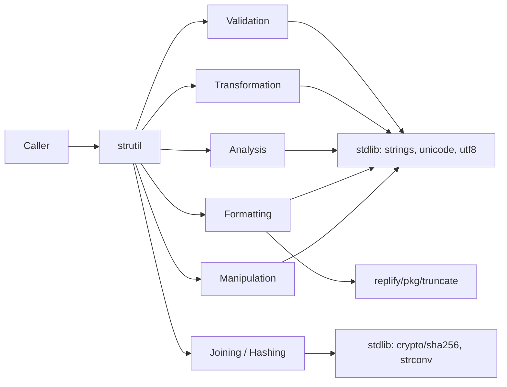

# strutil

[](https://go.dev/)
[](../../LICENSE)
[](https://pkg.go.dev/github.com/polarixa/replify/pkg/strutil)

**strutil** is a comprehensive Go string utility package exposing 124 pure functions for validation, transformation, analysis, formatting, and manipulation. It removes boilerplate and gives Go projects one consistent, well-tested vocabulary for string handling.

## Overview

The package covers the string operations that `strings` leaves out or handles inconsistently:

- **Validation** — emptiness, blankness, numeric/alpha/alphanumeric/whitespace classification
- **Transformation** — case conversion, camel/snake conversion, trimming, padding, slugging
- **Analysis** — prefix/suffix checks, substring matching, word detection, initials
- **Formatting** — centering, abbreviation, truncation, indentation, one-lining
- **Manipulation** — removal, replacement, reversal, repetition, slicing, overlay
- **Joining** — typed joins for `string`, `int`, `int64`, `uint64`, `float64`, `bool`
- **Hashing** — SHA-256 hex digests
- **Encoding helpers** — safe/unsafe `[]byte` ↔ `string` conversion

**Key features:**

- 🧩 **124 exported functions** — a single, discoverable surface for string work
- 🎯 **Rune-aware** — length, padding, reversal, and truncation count Unicode code points, not bytes
- 🔒 **Pure and thread-safe** — no package-level mutable state, safe for concurrent use
- 🧪 **Zero external dependencies** — standard library only (plus `pkg/truncate` for `Truncate`)
- 📦 **Single import** — `github.com/polarixa/replify/pkg/strutil`

## Use Cases

### When to Use

- ✅ **Input validation** — reject blank, non-numeric, or malformed fields
- ✅ **Data sanitization** — strip quotes, collapse whitespace, drop control characters
- ✅ **Text formatting** — title case, camel case, snake case, initials
- ✅ **URL/SEO slugs** — `Slugify` produces clean, accent-free, URL-safe paths
- ✅ **Display truncation** — cap labels and log lines without splitting multi-byte characters
- ✅ **Data extraction** — pull fields out of delimited records, slice substrings, overlay patches
- ✅ **Cache keys** — deterministic SHA-256 digests of composite strings
- ✅ **Report building** — join typed columns into CSV-ish output

### When Not to Use

- ❌ **Structured parsing** — use `encoding/json`, `encoding/xml`, or a dedicated parser
- ❌ **Complex pattern matching** — use the `regexp` package directly
- ❌ **Unicode-aware case folding / normalization** — use `golang.org/x/text`
- ❌ **Binary data** — use `bytes`; most `strutil` helpers are byte-oriented
- ❌ **Locale-sensitive formatting** — use `golang.org/x/text/width`, `currency`, or `message`

## Requirements

| Requirement | Version    |
| ----------- | ---------- |
| Go          | 1.24+ (CI matrix covers 1.23 – 1.25) |
| OS          | Any — pure Go, no cgo, no platform-specific code |

No database, service, or environment variable is required.

## Installation

```bash
go get github.com/polarixa/replify
```

Import the package:

```go
import "github.com/polarixa/replify/pkg/strutil"
```

## Quick Start

```go
package main

import (
	"fmt"

	"github.com/polarixa/replify/pkg/strutil"
)

func main() {
	// Validation
	fmt.Println(strutil.IsEmpty("   ")) // true
	fmt.Println(strutil.IsAlpha("abc")) // true

	// Transformation
	fmt.Println(strutil.Title("hello world"))       // "Hello World"
	fmt.Println(strutil.Slugify("Hello World!"))     // "hello-world"
	fmt.Println(strutil.ToSnakeCase("Hello World"))  // "hello_world"

	// Formatting
	fmt.Println(strutil.PadLeft("5", 3, "0"))    // "005"
	fmt.Println(strutil.Truncate("long text", 6)) // "long …"
	fmt.Println(strutil.Center("Hi", 6, "*"))   // "**Hi**"

	// Manipulation
	fmt.Println(strutil.ReplaceAll("hello", "l", "L")) // "heLLo"
	fmt.Println(strutil.Reverse("hello"))              // "olleh"
	fmt.Println(strutil.Initials("John Smith"))        // "JS"

	// Hashing
	fmt.Println(strutil.Hash256("password123"))
	// ef92b778bafe771e89245b89ecbc08a44a4e166c06659911881f383d4473e94f
}
```

## Examples

### 1. Emptiness and Blankness

`IsEmpty` and `IsBlank` behave identically — both treat whitespace-only strings as empty.

```go
strutil.IsEmpty("")            // true
strutil.IsEmpty("   ")         // true
strutil.IsEmpty("hello")       // false
strutil.IsNotEmpty("hello")    // true
strutil.IsBlank("   ")         // true
strutil.IsNotBlank("hello")    // true

strutil.IsAnyEmpty("a", "", "b")  // true
strutil.IsNoneEmpty("a", "b")     // true
strutil.IsAllEmpty("", "  ")      // true
strutil.IsAnyBlank("a", "  ")     // true
strutil.IsNoneBlank("a", "b")     // true
```

Pointer variants treat a `nil` pointer as empty/blank:

```go
var p *string
strutil.IsEmptyPtr(p)    // true
strutil.IsNotEmptyPtr(p) // false

strutil.IsAnyEmptyPtr(nil, &s)    // true
strutil.IsNoneEmptyPtr(&a, &b)    // true
strutil.IsAnyBlankPtr(nil)        // true
strutil.IsNoneBlankPtr(&s)        // true
```

There is no `IsAllBlankPtr` — the blank family only covers `IsBlank`, `IsNotBlank`,
`IsAnyBlank`, and `IsNoneBlank` in pointer form.

### 2. Character Classification

```go
strutil.IsAlpha("abc")             // true
strutil.IsAlpha("abc123")          // false
strutil.IsNumeric("12345")         // true
strutil.IsAlphanumeric("abc123")   // true
strutil.IsAlphaSpace("ab c")       // true
strutil.IsAlphanumericSpace("ab 1") // true
strutil.IsNumericSpace("12 3")     // true
strutil.IsWhitespace("   ")        // true
strutil.IsAllLowerCase("hello")    // true
strutil.IsAllUpperCase("HELLO")    // true
```

Pointer variants: `IsAlphaPtr`, `IsNumericPtr`, `IsNumericSpacePtr`, `IsWhitespacePtr`.

### 3. Trimming and Whitespace Normalization

There are two families with different semantics — pick deliberately.

```go
// Cutset family: the second argument is a LITERAL prefix/suffix,
// stripped repeatedly — not a set of characters (unlike strings.TrimLeft).
strutil.TrimLeft("###hello", "#")    // "hello"
strutil.TrimRight("hello###", "#")   // "hello"
strutil.TrimLeft("abcabd", "abc")    // "abd" — whole "abc" literals only
strutil.TrimLeft("lllello", "l")     // "ello" — a single-char cutset behaves as usual

// Trim: strips leading/trailing bytes <= ' ' (ASCII whitespace).
strutil.Trim("  hello  ")           // "hello"

// Strip family: regex-based, handles Unicode whitespace.
strutil.Strip("  hello  ")          // "hello"
strutil.StripStart("  hello  ")     // "hello  "
strutil.StripEnd("  hello  ")       // "  hello"

// Whitespace collapsing.
strutil.TrimWhitespace("  a   b  ") // " a b " — collapses runs, keeps one edge space
strutil.CleanSpaces("  a   b  ")    // "a b"     — collapses runs, then trims
```

Repeated-prefix/suffix helpers:

```go
strutil.TrimPrefixAll("##x##", "##")   // "x##"
strutil.TrimPrefixN("##x##", "##", 1)  // "x##"
strutil.TrimSuffixAll("##x##", "##")   // "##x"
strutil.TrimSuffixN("##x##", "##", 1)  // "##x"
strutil.TrimSequenceAll("##x##", "##") // "x"
```

Trailing-newline handling:

```go
strutil.Chomp("hello\n")    // "hello" — removes one trailing newline
strutil.Chomp("hello\r\n")  // "hello"
strutil.Chomp("hello")      // "hello" — unchanged when there is no newline
strutil.Chop("hello\n")     // "hello" — chomps the newline if present
strutil.Chop("hello")       // "hell"  — otherwise drops the last character
```

Whitespace-only input is returned unchanged by both:

```go
strutil.Chomp("\n") // "\n"
strutil.Chop("\n")  // "\n"
```

### 4. Case Conversion

```go
strutil.Capitalize("hello world")   // "Hello world" — first rune only
strutil.UnCapitalize("Hello")       // "hello"
strutil.Title("hello world")        // "Hello World"
strutil.Title("hello-world foo")    // "Hello-World Foo"
strutil.SwapCase("Hello World")     // "hELLO wORLD"
strutil.ToCamelCase("hello world")  // "helloWorld"
strutil.ToSnakeCase("Hello World")  // "hello_world"
```

`Title` treats every non-alphanumeric character except `_` as a word separator. `ToSnakeCase` only replaces literal spaces, so it does **not** split existing camelCase:

```go
strutil.ToSnakeCase("HelloWorld") // "helloworld"
```

### 5. Identifier Splitting

```go
strutil.SplitCamelCase("HTTPServer")     // []string{"HTTP", "Server"}
strutil.SplitCamelCase("userID")         // []string{"user", "ID"}
strutil.SplitCamelCase("a")              // []string{"a"}
```

### 6. Searching and Matching

```go
strutil.Contains("Hello World", "World")       // true
strutil.ContainsIgnoreCase("Hello", "hello")   // true
strutil.ContainsAny("Hello", "Foo", "ello")     // true
strutil.ContainsNone("Hello", "xyz", "123")     // true
strutil.ContainsAnyCharacter("hello", "el")    // true
strutil.ContainsNoneCharacter("hello", "xyz")  // true
strutil.ContainsOnly("abc", "a", "b", "c")      // true
strutil.ContainsAllWords("hello world", "hello", "world") // true
```

`ContainsOnly` matches **individual characters**, so pass each rune as a separate argument — `ContainsOnly("abc", "abc")` is `false`.

```go
strutil.StartsWith("Hello", "He")           // true
strutil.StartsWithIgnoreCase("Hello", "he") // true
strutil.StartsWithAny("Hello", "Hi", "He")  // true
strutil.EndsWith("Hello", "lo")             // true
strutil.EndsWithIgnoreCase("Hello", "LO")   // true
strutil.EndsWithAny("Hello", "lo", "llo")   // true
```

### 7. Removal and Replacement

```go
// Remove deletes every occurrence of a substring.
strutil.Remove("hello world", "world")   // "hello "
strutil.RemoveAll("a-b-c", "-")          // "abc"

// RemovePattern deletes every regex match.
strutil.RemovePattern("abc123", "[0-9]+") // "abc"

// RemoveStart / RemoveEnd strip a single leading / trailing occurrence.
strutil.RemoveEnd("Hello", "lo")             // "Hel"
strutil.RemoveEndIgnoreCase("Hello", "LO")   // "Hel"

// RemovePrefixes strips the first matching prefix from a candidate list.
strutil.RemovePrefixes("prefix_body", "pre") // "fix_body"

// Replace — first n occurrences.
strutil.Replace("hello", "l", "L", 1)      // "heLlo"
strutil.ReplaceAll("hello", "l", "L")      // "heLLo"
strutil.ReplaceIgnoreCase("Hello", "hello", "Hi") // "Hi" — first match only
strutil.ReplaceAllStrings([]string{"a", "b"}, "a", "x") // []string{"x", "b"}
```

`RemoveStart` / `RemoveStartIgnoreCase` currently drop one extra byte (see [Known Quirks](#known-quirks-bugs)):

```go
strutil.RemoveStart("Hello", "He") // "lo" (expected "llo")
```

### 8. Conditional Affixes

```go
strutil.PrependIfMissing("world", "hello ")       // "hello world"
strutil.PrependIfMissingIgnoreCase("world", "Hi ") // "Hi world"
strutil.AppendIfMissing("hello", " world")        // "hello world"
strutil.AppendIfMissingIgnoreCase("Hello", "!!!") // "Hello!!!"
```

The variadic tail lets you supply alternates — the string is left alone if it already ends with **any** of them:

```go
strutil.AppendIfMissing("report.csv", ".csv", ".xlsx")  // "report.csv"
strutil.AppendIfMissing("report.xlsx", ".csv", ".xlsx") // "report.xlsx"
strutil.AppendIfMissing("report", ".csv", ".xlsx")      // "report.csv"
```

### 9. Padding, Centering, Wrapping

```go
strutil.PadLeft("5", 3, "0")    // "005"
strutil.PadRight("5", 3, "0")   // "500"
strutil.Center("Hi", 6, "*")    // "**Hi**"
strutil.Wrap("hello", "***")    // "***hello***"
strutil.Unwrap("***hello***", "***") // "hello"
```

Padding uses rune counts, not bytes, and a **whitespace-only pad string is treated as no pad at all** (see [Known Quirks](#known-quirks-bugs)):

```go
strutil.PadLeft("Hi", 6, " ") // "Hi" — expected "    Hi"
```

### 10. Truncation and Abbreviation

`Truncate` delegates to `pkg/truncate` with the cut-ellipsis strategy (`…`, U+2026) and is rune-safe:

```go
strutil.Truncate("This is a long sentence", 10) // "This is a…"
strutil.Truncate("Long text here", 8)           // "Long te…"
strutil.Truncate("hello", 3)                    // "he…"
strutil.Truncate("hello", 0)                    // ""
strutil.Truncate("hello", -1)                   // "hello" — negative is a no-op
```

`Abbreviate` uses a three-dot marker and leaves short strings untouched:

```go
strutil.Abbreviate("Long text here", 8)       // "Long ..."
strutil.Abbreviate("Long text", 10)          // "Long text" — already fits
strutil.AbbreviateWithOffset("abcdefghij", 4, 7) // "abcd..."
```

### 11. Slicing, Overlays, and Extraction

```go
strutil.Mid("Hello World", 6, 5)     // "World"
strutil.Mid("Hello", 2, 100)         // "llo"
strutil.Overlay("Hello", "XY", 1, 3) // "HXYlo"
strutil.Initials("John Smith")       // "JS"
strutil.InitialsDelimited("John-Smith", "-") // "JS"
strutil.OnlyLetters("a1b2")          // "ab"
strutil.OnlyDigits("a1b2")           // "12"
strutil.RemoveDoubleQuotes(`"hi"`)   // "hi"
strutil.RemoveAccents("Héllo Wörld")  // "Hello World"
```

### 12. Slugification

```go
strutil.Slugify("Hello World!")             // "hello-world"
strutil.Slugify("Café Münch")               // "cafe-munch"
strutil.SlugifySpec("Hello_World!", "_")   // "hello_world"
strutil.Slugify("10 Tips for Better Code")  // "10-tips-for-better-code"
```

Accents are folded via `RemoveAccents` before slugging, and non-ASCII characters are dropped:

```go
strutil.Slugify("日本語") // "" — non-Latin scripts are not transliterated
```

### 13. Joining

```go
strutil.Join([]string{"a", "b"}, ",")    // "a,b"
strutil.Slash("api", "v1", "users")      // "api/v1/users"
strutil.JoinInt([]int{1, 2, 3}, ",")      // "1,2,3"
strutil.JoinInt64([]int64{1, 2}, ",")    // "1,2"
strutil.JoinUint64([]uint64{1, 2}, ",")  // "1,2"
strutil.JoinFloat64([]float64{1.5, 2.25}, ",") // "1.5,2.25"
strutil.JoinBool([]bool{true, false}, ",")      // "true,false"
```

`Join` normalizes separator boundaries so you never get doubled or missing separators:

```go
strutil.Join([]string{"a/", "/b"}, "/") // "a/b"
```

`JoinFloat64WithFormatAndPrecision` lets you pick the formatting verb — but its third
argument is passed straight through to `strconv.FormatFloat` as a **bit size**, so it only
accepts `32` or `64` (any other value panics). See [Known Quirks](#known-quirks-bugs).

```go
strutil.JoinFloat64WithFormatAndPrecision([]float64{1.5, 2.25}, 'f', 64, ",") // "1.5,2.25"
```

Note that `JoinFloat64` formats at 32-bit precision, so high-precision values are rounded:

```go
strutil.JoinFloat64([]float64{3.14159265358979}, ",") // "3.1415927"
```

### 14. Repetition, Reversal, and Reflow

```go
strutil.Repeat("abc", 3)                  // "abcabcabc"
strutil.RepeatWithSeparator("a", "-", 3)  // "a-a-a"
strutil.Reverse("hello")                  // "olleh"
strutil.Reverse("世界")                    // "界世" — rune-safe
strutil.ReverseDelimited("a-b-c", "-")    // "c-b-a"
strutil.Indent("a\nb\n", "  ")            // "  a\n  b\n  "
strutil.Oneline("a\nb\r\nc")              // "a b c"
```

`Oneline` replaces every Unicode line-break sequence (`\n`, `\r`, `\r\n`, `\t`, `\v`, `\f`, NEL, LS, PS) with a single space.

### 15. Defaults, Comparison, and Utilities

```go
strutil.DefaultIfEmpty("", "default")      // "default"
strutil.DefaultIfBlank("   ", "default")   // "default"
strutil.Equals("hi", "hi")                 // true
strutil.EqualsIgnoreCase("Hi", "hi")       // true
strutil.Len("Hello 世界")                   // 8 — rune count, not bytes
strutil.Hash256("password123")
// ef92b778bafe771e89245b89ecbc08a44a4e166c06659911881f383d4473e94f
strutil.TailLines([]string{"a", "b", "c"}, 2) // []string{"b", "c"}
strutil.Quote("hi")                           // `hi`
strutil.SafeStr([]byte("hi"))                 // "hi"
strutil.SafeBytes("hi")                       // []byte("hi")
```

### 16. Practical Patterns

#### Input validation

```go
func validateUsername(username string) error {
	if strutil.IsBlank(username) {
		return errors.New("username cannot be blank")
	}
	if !strutil.IsAlphanumeric(strings.ReplaceAll(username, "_", "")) {
		return errors.New("username must be alphanumeric")
	}
	if strutil.Len(username) < 3 {
		return errors.New("username must be at least 3 characters")
	}
	return nil
}
```

#### Creating URL slugs

```go
func createPostSlug(title string) string {
	// "My Awesome Post Title!" -> "my-awesome-post-title"
	slug := strutil.Slugify(title)

	// Ensure maximum length
	if strutil.Len(slug) > 50 {
		slug = strutil.Truncate(slug, 50)
		slug = strutil.TrimRight(slug, "-")
	}

	return slug
}
```

#### Sanitizing user input

```go
func sanitizeInput(input string) string {
	cleaned := strutil.CleanSpaces(input) // collapses runs, trims edges
	cleaned = strutil.RemoveDoubleQuotes(cleaned)
	return cleaned
}
```

#### Formatting names

```go
func formatName(firstName, lastName string) string {
	first := strutil.Capitalize(strings.ToLower(firstName))
	last := strutil.Capitalize(strings.ToLower(lastName))
	return first + " " + last
}
```

#### Generating cache keys

```go
func generateCacheKey(prefix string, params ...string) string {
	return strutil.Hash256(prefix + "-" + strutil.Join(params, "-"))
}
```

#### Flattening a log record

```go
func oneLine(level, msg string) string {
	return strutil.Oneline(level + " " + msg) // never emits a newline
}
```

## API Reference

### Validation — Emptiness

| Function                              | Description                                   | Example                             |
| ------------------------------------- | --------------------------------------------- | ----------------------------------- |
| `IsEmpty(s string) bool`              | True when `s` is empty or whitespace-only      | `IsEmpty("  ") // true`             |
| `IsEmptyPtr(s *string) bool`          | Pointer variant; `nil` is empty               | `IsEmptyPtr(nil) // true`           |
| `IsNotEmpty(s string) bool`           | Negation of `IsEmpty`                          | `IsNotEmpty("hi") // true`          |
| `IsNotEmptyPtr(s *string) bool`       | Pointer variant of `IsNotEmpty`               | `IsNotEmptyPtr(nil) // false`       |
| `IsAnyEmpty(strings ...string) bool`   | True when any argument is empty               | `IsAnyEmpty("a", "") // true`        |
| `IsAnyEmptyPtr(strings ...*string) bool` | Pointer variant of `IsAnyEmpty`             | `IsAnyEmptyPtr(nil) // true`         |
| `IsNoneEmpty(strings ...string) bool`  | True when no argument is empty                | `IsNoneEmpty("a", "b") // true`     |
| `IsNoneEmptyPtr(strings ...*string) bool` | Pointer variant of `IsNoneEmpty`          | `IsNoneEmptyPtr(nil) // false`       |
| `IsAllEmpty(ss ...string) bool`       | True when every argument is empty             | `IsAllEmpty("", "  ") // true`       |
| `IsBlank(s string) bool`              | True when `s` is empty or whitespace-only      | `IsBlank("  ") // true`              |
| `IsBlankPtr(s *string) bool`          | Pointer variant of `IsBlank`                  | `IsBlankPtr(nil) // true`            |
| `IsNotBlank(s string) bool`           | Negation of `IsBlank`                          | `IsNotBlank("hi") // true`           |
| `IsNotBlankPtr(s *string) bool`       | Pointer variant of `IsNotBlank`               | `IsNotBlankPtr(nil) // false`        |
| `IsAnyBlank(strings ...string) bool`   | True when any argument is blank               | `IsAnyBlank("a", " ") // true`       |
| `IsAnyBlankPtr(strings ...*string) bool` | Pointer variant of `IsAnyBlank`             | `IsAnyBlankPtr(nil) // true`         |
| `IsNoneBlank(strings ...string) bool`  | True when no argument is blank                | `IsNoneBlank("a", "b") // true`      |
| `IsNoneBlankPtr(strings ...*string) bool` | Pointer variant of `IsNoneBlank`          | `IsNoneBlankPtr(nil) // false`       |

### Validation — Character Classes

| Function                                | Description                                | Example                          |
| --------------------------------------- | ------------------------------------------ | -------------------------------- |
| `IsAlpha(s string) bool`                | Letters only                               | `IsAlpha("abc") // true`         |
| `IsAlphanumeric(s string) bool`         | Letters and digits                         | `IsAlphanumeric("a1") // true`   |
| `IsAlphaSpace(s string) bool`           | Letters and whitespace                     | `IsAlphaSpace("a b") // true`    |
| `IsAlphanumericSpace(s string) bool`    | Letters, digits, and whitespace            | `IsAlphanumericSpace("a 1") // true` |
| `IsNumeric(s string) bool`              | Digits only                                | `IsNumeric("12") // true`        |
| `IsNumericSpace(s string) bool`         | Digits and whitespace                      | `IsNumericSpace("1 2") // true`   |
| `IsWhitespace(s string) bool`           | Whitespace only                            | `IsWhitespace("  ") // true`      |
| `IsAllLowerCase(s string) bool`         | Every rune is lowercase                    | `IsAllLowerCase("ab") // true`    |
| `IsAllUpperCase(s string) bool`         | Every rune is uppercase                    | `IsAllUpperCase("AB") // true`    |
| `IsNumericPtr(s *string) bool`          | Pointer variant of `IsNumeric`             | `IsNumericPtr(nil) // false`       |
| `IsNumericSpacePtr(s *string) bool`     | Pointer variant of `IsNumericSpace`        | `IsNumericSpacePtr(nil) // false`  |
| `IsWhitespacePtr(s *string) bool`        | Pointer variant of `IsWhitespace`          | `IsWhitespacePtr(nil) // false`     |

The character-class family has no pointer variants for `IsAlpha`, `IsAlphanumeric`,
`IsAlphaSpace`, `IsAlphanumericSpace`, `IsAllLowerCase`, or `IsAllUpperCase`.
Every pointer variant in this family returns `false` for a `nil` pointer.

### Searching

| Function                                        | Description                                | Example                              |
| ----------------------------------------------- | ------------------------------------------ | ------------------------------------ |
| `Contains(s, search string) bool`               | Substring test                             | `Contains("hi", "i") // true`        |
| `ContainsIgnoreCase(s, search string) bool`     | Case-insensitive substring test            | `ContainsIgnoreCase("Hi", "hi") // true` |
| `ContainsAny(s string, search ...string) bool`  | Contains any of the given substrings       | `ContainsAny("hi", "x", "i") // true` |
| `ContainsNone(s string, search ...string) bool` | Contains none of the given substrings      | `ContainsNone("hi", "x") // true`    |
| `ContainsAnyCharacter(s, search string) bool`   | Contains any character of `search`         | `ContainsAnyCharacter("hello", "el") // true` |
| `ContainsNoneCharacter(s, search string) bool` | Contains no character of `search`          | `ContainsNoneCharacter("hello", "xyz") // true` |
| `ContainsOnly(s string, search ...string) bool` | Every rune appears in `search` (per rune)  | `ContainsOnly("ab", "a", "b") // true` |
| `ContainsAllWords(s string, words ...string) bool` | All words present as whole words       | `ContainsAllWords("a b", "a", "b") // true` |
| `StartsWith(s, prefix string) bool`            | Prefix test                                | `StartsWith("hi", "h") // true`      |
| `StartsWithIgnoreCase(s, prefix string) bool`  | Case-insensitive prefix test               | `StartsWithIgnoreCase("Hi", "hi") // true` |
| `StartsWithAny(s string, prefixes ...string) bool` | Any of the given prefixes              | `StartsWithAny("Hi", "Hi", "He") // true` |
| `EndsWith(s, suffix string) bool`              | Suffix test                                | `EndsWith("hi", "i") // true`        |
| `EndsWithIgnoreCase(s, suffix string) bool`    | Case-insensitive suffix test               | `EndsWithIgnoreCase("Hi", "HI") // true` |
| `EndsWithAny(s string, suffixes ...string) bool` | Any of the given suffixes                | `EndsWithAny("Hi", "Hi", "He") // true` |

### Trimming and Normalization

| Function                                     | Description                                   | Example                             |
| -------------------------------------------- | --------------------------------------------- | ----------------------------------- |
| `Trim(s string) string`                      | Trims leading/trailing bytes `<= ' '`         | `Trim("  hi  ") // "hi"`            |
| `TrimLeft(s, cutset string) string`          | Trims repeated literal prefixes       | `TrimLeft("###hi", "#") // "hi"`     |
| `TrimRight(s, cutset string) string`         | Trims repeated literal suffixes       | `TrimRight("hi###", "#") // "hi"`    |
| `TrimPrefixAll(s, prefix string) string`     | Removes every leading occurrence of `prefix`  | `TrimPrefixAll("##x", "#") // "x"`  |
| `TrimPrefixN(s, prefix string, n int) string`| Removes up to `n` leading occurrences          | `TrimPrefixN("###x", "#", 3) // "x"`|
| `TrimSuffixAll(s, suffix string) string`     | Removes every trailing occurrence of `suffix` | `TrimSuffixAll("x##", "#") // "x"`  |
| `TrimSuffixN(s, suffix string, n int) string`| Removes up to `n` trailing occurrences         | `TrimSuffixN("x###", "#", 3) // "x"`|
| `TrimSequenceAll(s, sequence string) string` | Removes the sequence from both ends           | `TrimSequenceAll("##x##", "##") // "x"` |
| `TrimWhitespace(s string) string`            | Collapses whitespace runs to one space        | `TrimWhitespace("a  b") // "a b"`   |
| `CleanSpaces(s string) string`               | Collapses runs, then trims edges              | `CleanSpaces("  a  b  ") // "a b"`  |
| `Strip(s string) string`                     | Regex trims Unicode whitespace from both ends | `Strip("  hi  ") // "hi"`           |
| `StripStart(s string) string`                | Regex trims leading Unicode whitespace        | `StripStart("  hi") // "hi"`        |
| `StripEnd(s string) string`                  | Regex trims trailing Unicode whitespace       | `StripEnd("hi  ") // "hi"`          |
| `RemovePrefixes(s string, prefixes ...string) string` | Removes the first matching prefix     | `RemovePrefixes("ab", "a") // "b"`  |
| `Chomp(s string) string`                    | Removes one trailing newline            | `Chomp("hi\n") // "hi"`             |
| `Chop(s string) string`                     | Removes the trailing newline, else the last character | `Chop("hi") // "h"` |
| `RemoveDoubleQuotes(s string) string`        | Removes every `"` character                  | `RemoveDoubleQuotes(`"hi"`) // "hi"`|
| `StripNonWhitespace(s string) string`        | ⚠️ Currently returns only the whitespace characters — see [Known Quirks](#known-quirks-bugs) | `StripNonWhitespace("abc") // ""` |

### Slugification

| Function                              | Description                                   | Example                                |
| ------------------------------------- | --------------------------------------------- | -------------------------------------- |
| `Slugify(s string) string`            | Lowercase, accent-folded, `-`-separated slug  | `Slugify("Hello World!") // "hello-world"` |
| `SlugifySpec(str, delimiter string) string` | Slug with a custom separator              | `SlugifySpec("Hello World", "_") // "hello_world"` |

### Case Conversion

| Function                          | Description                          | Example                            |
| --------------------------------- | ------------------------------------ | ---------------------------------- |
| `Capitalize(s string) string`     | Uppercases the first rune            | `Capitalize("hi") // "Hi"`         |
| `UnCapitalize(s string) string`   | Lowercases the first rune            | `UnCapitalize("Hi") // "hi"`       |
| `Title(s string) string`          | Title-cases each word                | `Title("hi world") // "Hi World"`  |
| `SwapCase(s string) string`       | Flips the case of every letter       | `SwapCase("Hi") // "hI"`           |
| `ToCamelCase(s string) string`    | `"hello world"` → `"helloWorld"`     | `ToCamelCase("a b") // "aB"`       |
| `ToSnakeCase(s string) string`    | `"Hello World"` → `"hello_world"`     | `ToSnakeCase("A B") // "a_b"`       |
| `SplitCamelCase(s string) []string` | Splits an identifier into words   | `SplitCamelCase("HTTPServer")`     |

### Removal and Replacement

| Function                                          | Description                              | Example                                  |
| ------------------------------------------------- | ---------------------------------------- | ---------------------------------------- |
| `Remove(str, remove string) string`              | Removes all occurrences of a substring   | `Remove("a-b-c", "-") // "abc"`          |
| `RemoveAll(s, remove string) string`             | Removes all occurrences of a substring   | `RemoveAll("a-b-c", "-") // "abc"`       |
| `RemoveStart(str, remove string) string`          | Removes one leading occurrence           | `RemoveStart("he-llo", "he-") // "lo"`   |
| `RemoveStartIgnoreCase(str, remove string) string`| Case-insensitive leading removal        | `RemoveStartIgnoreCase("HEllo", "he") // "lo"` |
| `RemoveEnd(str, remove string) string`            | Removes one trailing occurrence          | `RemoveEnd("Hello", "lo") // "Hel"`      |
| `RemoveEndIgnoreCase(str, remove string) string`  | Case-insensitive trailing removal        | `RemoveEndIgnoreCase("Hello", "LO") // "Hel"` |
| `RemovePattern(str, pattern string) string`      | Removes every regex match                | `RemovePattern("ab12", "[0-9]+") // "ab"` |
| `Replace(s, old, new string, n int) string`      | Replaces the first `n` occurrences        | `Replace("aaa", "a", "b", 2) // "bba"`  |
| `ReplaceAll(s, old, new string) string`          | Replaces every occurrence                 | `ReplaceAll("aaa", "a", "b") // "bbb"`  |
| `ReplaceIgnoreCase(s, old, new string) string`   | Replaces the first case-insensitive match | `ReplaceIgnoreCase("Hello", "hello", "Hi") // "Hi"` |
| `ReplaceAllStrings(ss []string, old, new string) []string` | Replaces in every element     | `ReplaceAllStrings([]string{"a"}, "a", "x")` |

### Conditional Affixes

| Function                                                     | Description                          | Example                                        |
| ------------------------------------------------------------ | ------------------------------------ | ---------------------------------------------- |
| `PrependIfMissing(str, prefix string, prefixes ...string) string` | Prepends `prefix` if absent     | `PrependIfMissing("world", "hello ") // "hello world"` |
| `PrependIfMissingIgnoreCase(str, prefix string, prefixes ...string) string` | Case-insensitive prepend | `PrependIfMissingIgnoreCase("world", "Hi ")`     |
| `AppendIfMissing(str, suffix string, suffixes ...string) string` | Appends `suffix` if absent         | `AppendIfMissing("hello", " world") // "hello world"` |
| `AppendIfMissingIgnoreCase(str, suffix string, suffixes ...string) string` | Case-insensitive append | `AppendIfMissingIgnoreCase("Hello", "!!!")`     |

### Formatting and Padding

| Function                                    | Description                              | Example                              |
| ------------------------------------------- | ---------------------------------------- | ------------------------------------ |
| `PadLeft(s string, size int, pad string) string`  | Pads on the left to `size` runes   | `PadLeft("5", 3, "0") // "005"`      |
| `PadRight(s string, size int, pad string) string` | Pads on the right to `size` runes  | `PadRight("5", 3, "0") // "500"`     |
| `Center(s string, size int, pad string) string`   | Centers within `size` runes       | `Center("Hi", 6, "*") // "**Hi**"`  |
| `Wrap(s, wrapWith string) string`          | Surrounds the string                  | `Wrap("hi", "*") // "*hi*"`          |
| `Unwrap(s, wrapper string) string`         | Removes a surrounding wrapper          | `Unwrap("**hi**", "**") // "hi"`     |
| `Truncate(s string, length int) string`    | Truncates with `…` (U+2026)             | `Truncate("hello", 3) // "he…"`      |
| `Abbreviate(str string, maxWidth int) string` | Abbreviates with `...`              | `Abbreviate("Long text here", 8) // "Long ..."` |
| `AbbreviateWithOffset(str string, offset, maxWidth int) string` | Abbreviates from an offset | `AbbreviateWithOffset("abcdefghij", 4, 7) // "abcd..."` |
| `Indent(s string, left string) string`     | Prefixes every line                    | `Indent("a\nb", "  ")`               |
| `Oneline(str string) string`               | Replaces line breaks with spaces        | `Oneline("a\nb") // "a b"`           |
| `Repeat(s string, repeat int) string`      | Repeats the string                      | `Repeat("ab", 3) // "ababab"`        |
| `RepeatWithSeparator(s, sep string, repeat int) string` | Repeats with a separator between | `RepeatWithSeparator("a", "-", 3) // "a-a-a"` |

### Joining

| Function                                                        | Description                          | Example                              |
| --------------------------------------------------------------- | ------------------------------------ | ------------------------------------ |
| `Join(elems []string, separator string) string`                 | Joins strings, normalizing separators | `Join([]string{"a", "b"}, ",") // "a,b"` |
| `Slash(elems ...string) string`                                 | Joins with `/`                       | `Slash("a", "b") // "a/b"`           |
| `JoinBool(a []bool, sep string) string`                         | Joins booleans                       | `JoinBool([]bool{true}, ",") // "true"` |
| `JoinInt(a []int, sep string) string`                           | Joins integers                       | `JoinInt([]int{1, 2}, ",") // "1,2"` |
| `JoinInt64(a []int64, sep string) string`                       | Joins int64 values                   | `JoinInt64([]int64{1}, ",") // "1"`  |
| `JoinUint64(ints []uint64, sep string) string`                  | Joins uint64 values                  | `JoinUint64([]uint64{1}, ",") // "1"`|
| `JoinFloat64(a []float64, sep string) string`                   | Joins float64 values at 32-bit precision | `JoinFloat64([]float64{1.5}, ",") // "1.5"` |
| `JoinFloat64WithFormatAndPrecision(a []float64, fmt byte, precision int, sep string) string` | Joins with an explicit verb; `precision` is passed as a `strconv` bit size and must be `32` or `64` | `JoinFloat64WithFormatAndPrecision([]float64{1.5}, 'f', 64, ",") // "1.5"` |

### Extraction, Slicing, and Hashing

| Function                                         | Description                       | Example                              |
| ------------------------------------------------ | --------------------------------- | ------------------------------------ |
| `Mid(str string, pos, size int) string`          | Byte-oriented substring slice     | `Mid("Hello World", 6, 5) // "World"`|
| `Overlay(str, overlay string, start, end int) string` | Replaces a byte range        | `Overlay("Hello", "XY", 1, 3) // "HXYlo"` |
| `Initials(str string) string`                    | First letter of each word         | `Initials("John Smith") // "JS"`    |
| `InitialsDelimited(str string, delimiters ...string) string` | Initials split on given delimiters | `InitialsDelimited("J-S", "-") // "JS"` |
| `OnlyLetters(sequence string) string`            | Keeps only letters                | `OnlyLetters("a1b2") // "ab"`       |
| `OnlyDigits(sequence string) string`             | Keeps only digits                 | `OnlyDigits("a1b2") // "12"`        |
| `RemoveAccents(s string) string`                 | Folds Latin accents to ASCII      | `RemoveAccents("Héllo") // "Hello"` |
| `Reverse(s string) string`                       | Reverses runes                    | `Reverse("hello") // "olleh"`       |
| `ReverseDelimited(str, del string) string`       | Reverses delimiter-separated parts| `ReverseDelimited("a-b-c", "-") // "c-b-a"` |
| `Hash256(s string) string`                       | SHA-256 hex digest                | `Hash256("text")`                   |
| `TailLines(lines []string, num int) []string`    | Last `num` lines                  | `TailLines([]string{"a", "b"}, 1) // ["b"]` |
| `Quote(arg string) string`                       | Back-quoted Go literal            | `Quote("hi") // "`hi`"`             |
| `SafeStr(b []byte) string`                       | `[]byte` → `string` (copy)        | `SafeStr([]byte("hi")) // "hi"`     |
| `UnsafeStr(b []byte) string`                     | `[]byte` → `string` (no copy)     | `UnsafeStr(buf) // "hi"`            |
| `SafeBytes(s string) []byte`                     | `string` → `[]byte` (copy)        | `SafeBytes("hi") // []byte("hi")`  |

### Comparison and Defaults

| Function                                | Description                   | Example                            |
| --------------------------------------- | ----------------------------- | ---------------------------------- |
| `Equals(a, b string) bool`             | Byte equality                 | `Equals("hi", "hi") // true`       |
| `EqualsIgnoreCase(a, b string) bool`   | Unicode case-folded equality | `EqualsIgnoreCase("Hi", "hi") // true` |
| `DefaultIfEmpty(s, defaultValue string) string` | Default when empty     | `DefaultIfEmpty("", "x") // "x"`   |
| `DefaultIfBlank(s, defaultValue string) string` | Default when blank     | `DefaultIfBlank(" ", "x") // "x"`  |

### Global Variables

| Variable         | Type            | Description                                                        |
| ---------------- | --------------- | ------------------------------------------------------------------ |
| `Len`            | `func(string) int` | Alias for `utf8.RuneCountInString` — Unicode-aware length       |
| `RegexpDupSpaces`| `*regexp.Regexp` | Precompiled `\s+` matcher for collapsing whitespace runs         |
| `MaxRuneBytes`   | `[4]byte`       | Maximum valid UTF-8 encoding of a code point (`[244 143 191 191]`) |

## Best Practices & Notes

### ⚠️ Common Pitfalls

1. **Byte length vs. rune length**

   ```go
   // ❌ len() counts bytes
   text := "Hello 世界"
   n := len(text) // 13 bytes

   // ✅ rune count
   n := strutil.Len(text) // 8 characters
   ```

2. **`TrimLeft` / `TrimRight` take a literal, not a character set**

   They strip repeated occurrences of the whole `cutset` string, so a multi-character
   cutset behaves differently from `strings.TrimLeft` / `strings.TrimRight`:

   ```go
   strutil.TrimLeft("abcabd", "abc") // "abd" — strips whole "abc" literals
   strings.TrimLeft("abcabd", "abc") // "d"   — strips any of a, b, c
   ```

   A single-character cutset behaves the same as the standard library:

   ```go
   strutil.TrimLeft("lllello", "l") // "ello"
   ```

3. **`ContainsOnly` compares runes, not substrings**

   ```go
   // ❌ "abc" is treated as the candidate set {"abc"}
   strutil.ContainsOnly("abc", "abc") // false

   // ✅ one argument per character
   strutil.ContainsOnly("abc", "a", "b", "c") // true
   ```

4. **Padding and trimming are Unicode-unaware in places**

   `Trim` strips bytes `<= ' '` only — it will not remove U+00A0 (non-breaking space). `Strip*` uses regexes and does handle Unicode whitespace.

5. **`ToSnakeCase` does not split camelCase**

   ```go
   strutil.ToSnakeCase("HelloWorld") // "helloworld"
   strutil.SplitCamelCase("HelloWorld") // ["Hello", "World"] — use this instead
   ```

6. **`Hash256` returns an empty string for blank input**

   ```go
   strutil.Hash256("")    // ""
   strutil.Hash256("   ") // "   " — the input is returned unchanged
   ```

   Guard before hashing if you need a stable digest for empty values.

7. **`Slugify` drops non-Latin scripts**

   ```go
   strutil.Slugify("日本語") // ""
   ```

   Transliterate first if you need non-Latin slugs.

8. **`Abbreviate` never shortens a string that already fits**

   ```go
   strutil.Abbreviate("Long text", 10) // "Long text" — not "Long te..."
   ```

9. **Float joining loses precision**

   ```go
   strutil.JoinFloat64([]float64{3.14159265358979}, ",") // "3.1415927" — float32 precision
   ```

   `JoinFloat64` formats at 32-bit precision, and `JoinFloat64WithFormatAndPrecision`
   treats its `precision` argument as a `strconv` bit size (only `32` and `64` are valid;
   anything else panics). Use `strconv.FormatFloat` when you need exact decimal control.

### 💡 Recommendations

✅ **Use semantic names**

```go
if strutil.IsEmpty(userInput) {
	return errors.New("input required")
}
```

✅ **Chain transformations instead of nesting calls**

```go
slug := strutil.Slugify(strutil.CleanSpaces(title))
```

✅ **Validate early at the boundary**

```go
func ProcessUser(name, email string) error {
	if strutil.IsAnyEmpty(name, email) {
		return errors.New("name and email required")
	}
	// ...
}
```

✅ **Prefer `strutil.Len` over `len` for user-facing text**

```go
if strutil.Len(title) > 80 { // characters, not bytes
	// ...
}
```

✅ **Reuse the precompiled `RegexpDupSpaces` for whitespace collapsing**

```go
cleaned := strutil.RegexpDupSpaces.ReplaceAllString(input, " ")
```

✅ **Cache hash results when used on a hot path**

```go
type User struct {
	Email     string
	EmailHash string
}

func NewUser(email string) *User {
	return &User{Email: email, EmailHash: strutil.Hash256(email)}
}
```

### 🔒 Thread Safety

Every function is **pure** — no package-level mutable state — so all of them are safe for concurrent use:

```go
var wg sync.WaitGroup
for i := 0; i < 100; i++ {
	wg.Add(1)
	go func(id int) {
		defer wg.Done()
		slug := strutil.Slugify(fmt.Sprintf("Title %d", id))
		_ = slug
	}(i)
}
wg.Wait()
```

The only shared objects are the package-level `Len` function, `RegexpDupSpaces`, and `MaxRuneBytes`. `*regexp.Regexp` is safe for concurrent use, and `Len` and `MaxRuneBytes` are read-only.

### ⚡ Performance Tips

**Fast operations:**

- ✅ `IsEmpty`, `IsNotEmpty` — O(n) trim, no allocation
- ✅ `StartsWith`, `EndsWith` — O(prefix/suffix length)
- ✅ `Len` — O(n), no allocation

**Moderate operations:**

- ⚠️ `Slugify` — accent folding plus a rune scan
- ⚠️ `Title` — a pass over every rune
- ⚠️ `Remove`, `Replace` — repeated re-scans

**Expensive operations:**

- 🐌 `Hash256` — cryptographic digest; use for integrity, not throughput
- 🐌 `Reverse` — allocates a rune slice

**Optimization strategies:**

1. **Reuse compiled regexes** — prefer `RegexpDupSpaces` over `regexp.MustCompile` in a loop
2. **Avoid repeated conversions** — don't call `Trim` twice
3. **Batch operations** — one `CleanSpaces` call instead of `Trim` + `ReplaceAll`
4. **Cache results** — store computed slugs, initials, and hashes

### 🐛 Debugging Tips

**Print intermediate results:**

```go
input := " Hello World! "
fmt.Printf("original: %q\n", input)
fmt.Printf("cleaned:  %q\n", strutil.CleanSpaces(input))
fmt.Printf("slug:     %q\n", strutil.Slugify(input))
```

**Check for empty results:**

```go
if strutil.IsEmpty(result) {
	log.Printf("warning: empty result from %q", input)
}
```

**Compare transformations side by side:**

```go
original := "Test String"
fmt.Printf("%q -> %q\n", original, strutil.Slugify(original))
```

### 📝 Testing

Table-driven tests work well with this API:

```go
func TestSlugify(t *testing.T) {
	tests := []struct {
		input    string
		expected string
	}{
		{"Hello World", "hello-world"},
		{"Hello  World", "hello-world"},
		{"Hello-World!", "hello-world"},
		{"", ""},
		{"   ", ""},
		{"CamelCase", "camelcase"},
	}

	for _, tt := range tests {
		t.Run(tt.input, func(t *testing.T) {
			got := strutil.Slugify(tt.input)
			if got != tt.expected {
				t.Errorf("Slugify(%q) = %q, want %q", tt.input, got, tt.expected)
			}
		})
	}
}
```

Run the package's own suite with:

```bash
go test ./pkg/strutil/...
```

## Known Quirks (Bugs)

These functions currently behave differently from what their names and doc comments imply. They are documented here so you are not surprised — and so the fixes can be prioritized.

| Function                                    | Current behavior                    | Expected                                   |
| ------------------------------------------- | ----------------------------------- | ------------------------------------------ |
| `RemoveStart` / `RemoveStartIgnoreCase`     | Drops one extra byte                | `RemoveStart("Hello", "He")` → `"llo"`     |
| `PadLeft` / `PadRight` / `Center`           | Treats a whitespace-only pad as empty | `PadLeft("Hi", 6, " ")` → `"    Hi"`       |
| `StripNonWhitespace`                        | Returns only the whitespace characters | Returns the string with whitespace removed |
| `ContainsOnly`                              | Compares each rune against whole arguments | Expects one argument per character |
| `Repeat` / `RepeatWithSeparator`            | Returns the input unchanged for `n <= 0` | Returns `""` for `n <= 0`             |
| `JoinFloat64WithFormatAndPrecision`         | Passes `precision` as `strconv`'s `bitSize`; panics unless it is `32` or `64` | Formats at the requested decimal precision |

`StripNonWhitespace` and `Center` are also inconsistent with their signatures and should not be relied on until fixed.

Workarounds until these are fixed upstream:

```go
// RemoveStart
strings.TrimPrefix(s, prefix) // stdlib, no off-by-one

// Padding with spaces
strutil.PadLeft(s, size, "-") // use a non-blank pad character

// ContainsOnly — pass one rune per argument
strutil.ContainsOnly(s, "a", "b", "c")

// Repeat
if n > 0 { out = strutil.Repeat(s, n) } else { out = "" }

// Float joining
strconv.FormatFloat(v, 'f', 2, 64) // stdlib, when you need real precision
```

## Limitations

- **No internationalization** — use `golang.org/x/text` for i18n and locale-aware casing
- **Basic pattern matching only** — `RemovePattern` and `ContainsAllWords` compile a regex per call
- **ASCII-focused slugging** — non-Latin scripts are dropped rather than transliterated
- **No streaming operations** — every call operates on a complete string in memory
- **Byte-oriented slicing** — `Mid` and `Overlay` use byte offsets, not rune offsets
- **No locale-aware formatting** — case conversion follows Go's default Unicode rules

## Architecture



`strutil` depends only on the Go standard library, plus `github.com/polarixa/replify/pkg/truncate` for the `Truncate` helper.

## Performance Characteristics

| Operation type   | Time complexity | Memory |
| ---------------- | --------------- | ------ |
| Emptiness check  | O(n)            | O(1)   |
| Case conversion  | O(n)            | O(n)   |
| Substring search | O(n×m)          | O(1)   |
| Trim / Strip     | O(n)            | O(n)   |
| Replace          | O(n)            | O(n)   |
| Slugify          | O(n)            | O(n)   |
| Hash256          | O(n)            | O(1)   |
| Reverse          | O(n)            | O(n)   |

Where n = string length in bytes, m = substring length.

## Contributing

Contributions are welcome. Please see the main [replify repository](https://github.com/polarixa/replify) for contribution guidelines.

```bash
git clone --depth 1 https://github.com/polarixa/replify.git
cd replify
go mod tidy
go test ./pkg/strutil/...
```

Please include tests for any new or changed behavior, and keep the examples in this README in sync with the implementation.

## License

Licensed under the **Apache License 2.0**; see [LICENSE](../../LICENSE).

## Related

Part of the **replify** ecosystem:

- [replify](https://github.com/polarixa/replify) — API response wrapping library
- [truncate](https://github.com/polarixa/replify/pkg/truncate) — truncation strategies used by `strutil.Truncate`
- [strchain](https://github.com/polarixa/replify/pkg/strchain) — fluent string builder
- [conv](https://github.com/polarixa/replify/pkg/conv) — type conversion utilities
- [hashy](https://github.com/polarixa/replify/pkg/hashy) — deterministic hashing
- [match](https://github.com/polarixa/replify/pkg/match) — wildcard pattern matching
- [coll](https://github.com/polarixa/replify/pkg/coll) — collection utilities

---

**Note:** This package exposes 124 exported functions. For the authoritative, always-current API, see the [package documentation on pkg.go.dev](https://pkg.go.dev/github.com/polarixa/replify/pkg/strutil).
